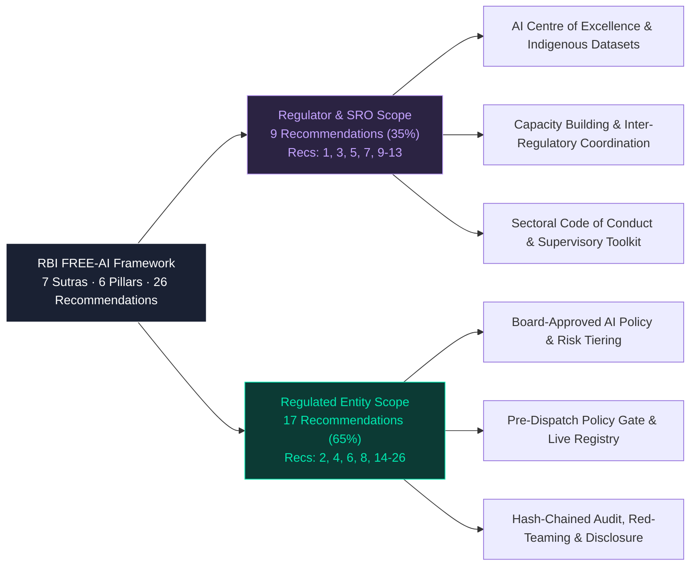
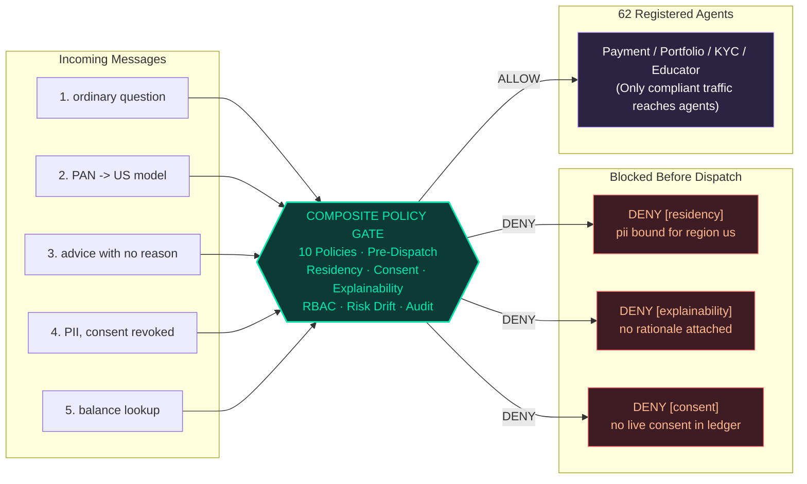
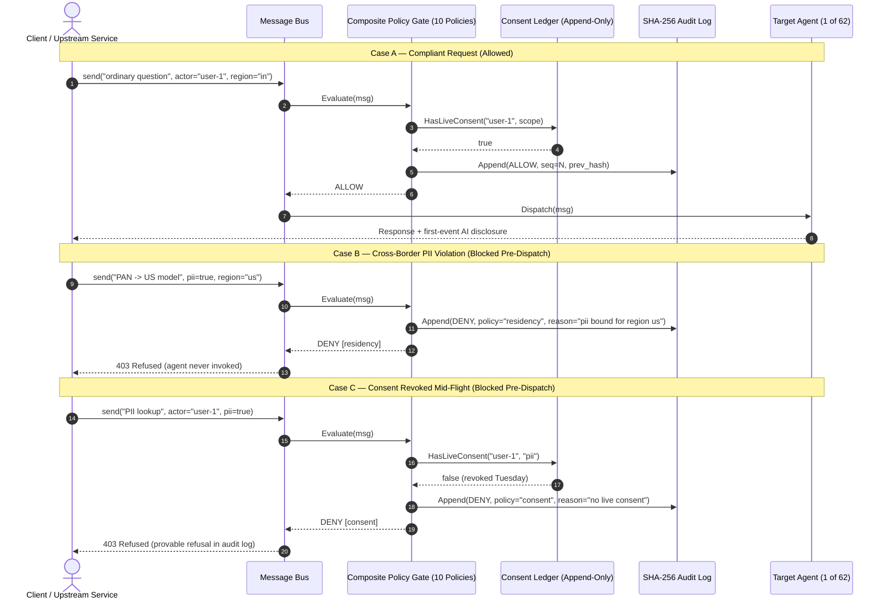
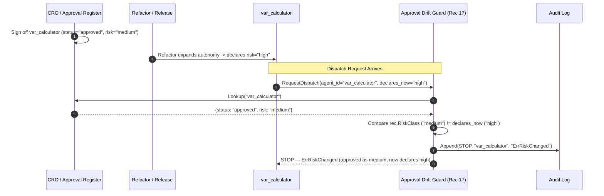
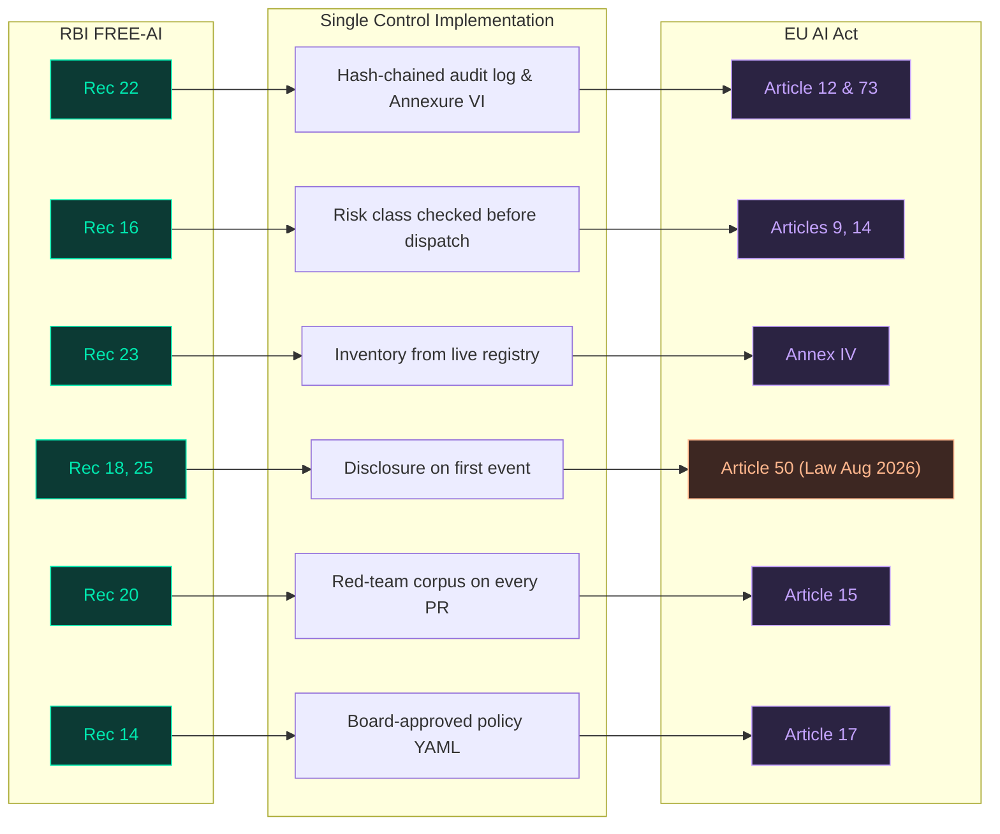

# Build for RBI, Inherit the EU AI Act

[](https://build-for-rbi-talk.vercel.app)
[](https://build-for-rbi-talk.vercel.app)
[](#2-the-9--17-split-scoping-rbi-free-ai-correctly)
[](#6-regulatory-convergence-rbi-free-ai--eu-ai-act)
[](#7-the-binding-instrument-rbi-draft-model-risk-management-guidance)

> **What RBI FREE-AI asks of your codebase — and how much of the EU AI Act comes with it.**  
> Presented by **Pratik Dhanave** (AI Architect, ClearRoute) at **FDExHyderabad · 28 November 2026**.

---

## Table of Contents

1. [The Short Version](#1-the-short-version)
2. [The 9 / 17 Split: Scoping RBI FREE-AI Correctly](#2-the-9--17-split-scoping-rbi-free-ai-correctly)
3. [Architecture: One Gate, Every Message](#3-architecture-one-gate-every-message)
4. [Message Sequence Diagrams](#4-message-sequence-diagrams)
   - [4.1 Pre-Dispatch Composite Policy Enforcement](#41-pre-dispatch-composite-policy-enforcement)
   - [4.2 Finding 1 — Runtime Approval Drift Detection (`ErrRiskChanged`)](#42-finding-1--runtime-approval-drift-detection-errriskchanged)
   - [4.3 Finding 2 — Tamper-Evident SHA-256 Audit Chain & Export Verification](#43-finding-2--tamper-evident-sha-256-audit-chain--export-verification)
5. [Code Snippets & Runnable Labs](#5-code-snippets--runnable-labs)
   - [5.1 The Five-Minute Offline Procurement Test](#51-the-five-minute-offline-procurement-test)
   - [5.2 Composite Policy Gate Pattern (Go)](#52-composite-policy-gate-pattern-go)
   - [5.3 Finding 1 — Runtime Risk-Drift Guard (Go)](#53-finding-1--runtime-risk-drift-guard-go)
   - [5.4 Lab 01 — Five Agents, One Bad Approval (`approval.py`)](#54-lab-01--five-agents-one-bad-approval-approvalpy)
   - [5.5 Lab 02 — Rewrite One Row, Watch It Fail (`audit.py`)](#55-lab-02--rewrite-one-row-watch-it-fail-auditpy)
   - [5.6 Board-Approved Policy-as-Config (`policy.yaml`)](#56-board-approved-policy-as-config-policyyaml)
6. [Regulatory Convergence: RBI FREE-AI ↔ EU AI Act](#6-regulatory-convergence-rbi-free-ai--eu-ai-act)
7. [The Binding Instrument: RBI Draft Model Risk Management Guidance](#7-the-binding-instrument-rbi-draft-model-risk-management-guidance)
8. [Two Open Engineering Problems (Gaps Named, Not Closed)](#8-two-open-engineering-problems-gaps-named-not-closed)
9. [Deployer vs. Provider: The Scoping Clause That Belongs in the SOW](#9-deployer-vs-provider-the-scoping-clause-that-belongs-in-the-sow)
10. [Using the Interactive Web Deck & PowerPoint](#10-using-the-interactive-web-deck--powerpoint)

---

## 1. The Short Version

| Metric | Count | Meaning |
| --- | :---: | --- |
| **RBI FREE-AI (Regulated Entity)** | **17 / 17** | All 17 recommendations owned by a Regulated Entity — implemented in working code |
| **EU AI Act Controls Inherited** | **7** | Controls built for RBI that directly answer EU AI Act Articles 9, 12, 14, 15, 17, 50, 73 & Annex IV |
| **RBI Draft MRM Gaps** | **2** | Named transparently against the 24 June 2026 Draft MRM guidance — not closed, not hidden |
| **Network Dependency** | **0** | Runs offline on a laptop — no cloud account, no API key, no network required |

### Where the Requirements Came From
These constraints came from regulated **Open Banking delivery across ADGM, DIFC, and SAMA** — not from reading policy PDFs:

- **`REG` — Residency, per message:** Not per deployment; you cannot fork the platform once per country.
- **`RISK` — Consent as an append-only ledger:** If a customer revokes consent on Tuesday, an in-flight request must fail — and the record must prove it failed for that exact reason.
- **`BANK` — An answer on demand:** Every partner bank can ask where their customer's data went, and *"encrypted at rest"* is not an answer.

> Three different stakeholders asked for those guarantees. **None of them could be satisfied by a slide.**

---

## 2. The 9 / 17 Split: Scoping RBI FREE-AI Correctly

RBI published the **FREE-AI** (*Framework for Responsible and Ethical Enablement of AI*) committee report on **13 August 2025**: **7 Sutras · 6 Pillars · 26 Recommendations**.

Before quoting or scoping a regulated AI engagement, separate what the regulator owns from what the Regulated Entity must build:



> Quote for all 26 recommendations and you have priced the regulator's own roadmap. **17** is the actual engineering scope of a Regulated Entity engagement.

---

## 3. Architecture: One Gate, Every Message

Instead of scattering compliance checks across 62 individual agents, **every message traverses one Composite Policy Gate before dispatch**. Ten policies run deterministically before any agent ever sees the payload.



**One place to audit. One place to change.** When the next regulatory clause lands, it becomes a policy config change — not a 62-agent rewrite.

---

## 4. Message Sequence Diagrams

### 4.1 Pre-Dispatch Composite Policy Enforcement



---

### 4.2 Finding 1 — Runtime Approval Drift Detection (`ErrRiskChanged`)

An approval describes a system **as it was on the day it was signed**. When `var_calculator` is refactored from `medium` to `high` risk, nobody rejected or withdrew it — the approval register simply went stale. The gate catches that drift at dispatch time:



---

### 4.3 Finding 2 — Tamper-Evident SHA-256 Audit Chain & Export Verification

A control that cannot catch its own operator is not a control. Each audit entry binds `prev_hash` into its SHA-256 digest, and the signed export manifest **always reports whether verification held — including when it did not**.

```mermaid
sequenceDiagram
    autonumber
    participant System as Policy Gate
    participant Log as Append-Only Hash Chain
    participant Operator as Privileged Operator (Tamper)
    participant Verifier as Export Verifier / Auditor

    System->>Log: append(seq=1, prev="genesis", action="consent.grant") -> h1
    System->>Log: append(seq=2, prev=h1, action="portfolio.read", actor="advisor-7") -> h2
    System->>Log: append(seq=3, prev=h2, action="refund.issue") -> h3

    Verifier->>Log: verify(log)
    Log-->>Verifier: OK (all row_hash and prev_hash links match)

    Note over Operator,Log: Quiet History Edit Attempt
    Operator->>Log: UPDATE seq=2 SET actor="advisor-99"

    Verifier->>Log: verify(log) & export_manifest()
    Log-->>Verifier: BROKEN at seq 2 (recomputed row_hash != stored h2; h3 link severed)
    Verifier-->>Verifier: Emit manifest {count: 3, chain_verified: false, sha256: "7f3c1a9d..."}
```

---

## 5. Code Snippets & Runnable Labs

### 5.1 The Five-Minute Offline Procurement Test

A control nobody can run is a claim. It is a fair test to put to any AI vendor — and a fairer one to put to yourself:

```bash
# No cloud account. No API key. No network.
git clone <repo> && cd genie
go test ./...        # -> 127 packages ok
go run ./cmd/genie   # -> full pipeline, sample CSV, ~30s
```

---

### 5.2 Composite Policy Gate Pattern (Go)

Every message passes through an ordered chain of deterministic policy checks before dispatch:

```go
package gate

import (
	"context"
	"fmt"
)

type Message struct {
	ActorID      string
	AgentID      string
	Region       string
	ContainsPII  bool
	IsAdvice     bool
	Rationale    string
	DeclaredRisk string
}

type Policy interface {
	Name() string
	Check(ctx context.Context, msg Message) error
}

type CompositeGate struct {
	Policies []Policy
	Audit    AuditLogger
}

func (g *CompositeGate) Allow(ctx context.Context, msg Message) error {
	for _, p := range g.Policies {
		if err := p.Check(ctx, msg); err != nil {
			_ = g.Audit.RecordDeny(msg, p.Name(), err.Error())
			return fmt.Errorf("DENY [%s]: %w", p.Name(), err)
		}
	}
	_ = g.Audit.RecordAllow(msg)
	return nil
}
```

---

### 5.3 Finding 1 — Runtime Risk-Drift Guard (Go)

From `approval_gate.go` — catching silent governance drift (RBI FREE-AI Rec 17):

```go
if rec.RiskClass != risk {
    return fmt.Errorf("%w: %s approved as %s, now declares %s",
        ErrRiskChanged, a.ID(), rec.RiskClass, risk)
}
```

---

### 5.4 Lab 01 — Five Agents, One Bad Approval (`approval.py`)

Interactive in **Slide 10** of [https://build-for-rbi-talk.vercel.app/#10](https://build-for-rbi-talk.vercel.app/#10) (press **`R`** to run live in browser via Pyodide):

```python
from datetime import datetime, timedelta

NOW = datetime(2026, 11, 28, 10, 0)

REGISTER = {
    "payment_orchestrator": dict(
        status="approved", risk="high", expires=NOW + timedelta(days=60)
    ),
    "kyc_orchestrator": dict(
        status="approved", risk="high", expires=NOW - timedelta(days=1)
    ),
    "aml_monitor": dict(status="rejected", risk="high"),
    "var_calculator": dict(status="approved", risk="medium"),  # signed off at medium
    "educator": None,  # never reviewed
}


def allow(agent_id, declares_now):
    if declares_now != "high":
        return True, "low/medium — no approval required"
    rec = REGISTER.get(agent_id)
    if rec is None:
        return False, "ErrNoApproval"
    if rec["status"] != "approved":
        return False, f"ErrNotApproved ({rec['status']})"
    if rec.get("expires") and NOW > rec["expires"]:
        return False, "ErrExpired"
    if rec["risk"] != declares_now:
        return False, (
            f"ErrRiskChanged (approved as {rec['risk']}, now declares {declares_now})"
        )
    return True, "live"


today = [
    ("payment_orchestrator", "high"),
    ("kyc_orchestrator", "high"),
    ("aml_monitor", "high"),
    ("var_calculator", "high"),
    ("educator", "low"),
]

for agent_id, risk in today:
    ok, why = allow(agent_id, risk)
    print(f"{'RUN ' if ok else 'STOP'}  {agent_id:<22} {why}")

print()
print("var_calculator is the one I would have missed.")
```

**Expected Output:**

```text
RUN   payment_orchestrator   live
STOP  kyc_orchestrator       ErrExpired
STOP  aml_monitor            ErrNotApproved (rejected)
STOP  var_calculator         ErrRiskChanged (approved as medium, now declares high)
RUN   educator               low/medium — no approval required

var_calculator is the one I would have missed.
```

---

### 5.5 Lab 02 — Rewrite One Row, Watch It Fail (`audit.py`)

Interactive in **Slide 13** of [https://build-for-rbi-talk.vercel.app/#13](https://build-for-rbi-talk.vercel.app/#13) (press **`R`** to run live in browser via Pyodide):

```python
import hashlib
import json


def row_hash(prev, entry):
    body = json.dumps({"prev": prev, **entry}, sort_keys=True).encode()
    return hashlib.sha256(body).hexdigest()


def append(log, actor, action, target):
    prev = log[-1]["row_hash"] if log else "genesis"
    e = {"seq": len(log) + 1, "actor": actor, "action": action, "target": target}
    e["prev_hash"] = prev
    e["row_hash"] = row_hash(prev, e)
    log.append(e)


def verify(log):
    prev = "genesis"
    for e in log:
        if e["prev_hash"] != prev:
            return False, e["seq"], "prev_hash"
        chk = {k: v for k, v in e.items() if k != "row_hash"}
        if row_hash(prev, chk) != e["row_hash"]:
            return False, e["seq"], "row_hash"
        prev = e["row_hash"]
    return True, None, None


log = []
append(log, "system",       "consent.grant",  "user-1")
append(log, "advisor-7",    "portfolio.read", "user-1")
append(log, "payment_orch", "refund.issue",   "txn-9931")

ok, seq, field = verify(log)
print("fresh chain          ", "OK" if ok else f"BROKEN at seq {seq} ({field})")

log[1]["actor"] = "advisor-99"  # someone edits history
ok, seq, field = verify(log)
print("after one edited row ", "OK" if ok else f"BROKEN at seq {seq} ({field})")

payload = "\n".join(json.dumps(e, sort_keys=True) for e in log).encode()
manifest = {
    "count": len(log),
    "chain_verified": ok,
    "sha256": hashlib.sha256(payload).hexdigest()[:24] + "…",
}
print()
print("export manifest      ", manifest)
print()
print("The export does not hide the break. It reports it.")
```

**Expected Output:**

```text
fresh chain           OK
after one edited row  BROKEN at seq 2 (row_hash)

export manifest       {'count': 3, 'chain_verified': False, 'sha256': '9f3c4dc6a8ff560f326e014a…'}

The export does not hide the break. It reports it.
```

---

### 5.6 Board-Approved Policy-as-Config (`policy.yaml`)

Declarative governance configuration answering both **RBI FREE-AI Rec 14** and **EU AI Act Article 17** so new regulatory clauses are config updates rather than code rewrites:

```yaml
version: "2026.11"
approved_by: "board-risk-committee@bank"
effective_date: "2026-11-28"

policies:
  residency:
    enforce_per_message: true
    pii_allowed_regions: ["in", "adgm", "difc", "sama"]
    deny_regions: ["us"]

  consent:
    mode: "append-only-ledger"
    fail_in_flight_on_revocation: true

  explainability:
    require_rationale_for: ["advice", "credit_decision", "loan_decision"]

  approval_drift:
    high_risk_requires_active_signoff: true
    block_on_risk_class_change: true # ErrRiskChanged

  disclosure:
    emit_on_first_event: true # RBI Rec 18/25 & EU AI Act Art 50

  audit:
    hash_algorithm: "sha256"
    anchor_external_timestamp: true
    report_broken_chain_in_manifest: true
```

---

## 6. Regulatory Convergence: RBI FREE-AI ↔ EU AI Act

The EU AI Act reaches you **the moment your output is used in Europe** — regardless of where the system was engineered. Regulators converge because there are only so many ways to make an automated system accountable.



### Reusable Cross-Walk (One Implementation, Two Evidence Packs)

| Control Implemented | RBI FREE-AI | EU AI Act |
| --- | --- | --- |
| Hash-chained audit log | `Rec 22` | `Article 12` |
| Annexure VI incident form *(RBI's prescribed AI-incident report)* | `Rec 22` | `Article 73` |
| Risk class checked before dispatch | `Rec 16` | `Articles 9, 14` |
| Inventory from the live registry | `Rec 23` | `Annex IV` |
| Red-team corpus on every PR | `Rec 20` | `Article 15` |
| Disclosure on the first event | `Rec 18, 25` | `Article 50` *(law since 2 Aug 2026)* |
| Board-approved policy YAML | `Rec 14` | `Article 17` |

---

## 7. The Binding Instrument: RBI Draft Model Risk Management Guidance

FREE-AI is an advisory committee report. The instrument that will actually bind regulated entities is the **RBI Draft Model Risk Management (MRM) Guidance**:

- **24 June 2026:** Issued for public consultation
- **24 July 2026:** Industry comments closed
- **Pending:** Final binding circular

### Honest Scorecard Against the Draft

| What the RBI Draft MRM Guidance Requires | Status |
| --- | :---: |
| Board-approved model risk framework | ✅ **Built** |
| Full model inventory, nothing running outside it | ✅ **Built** |
| Risk tiering by materiality, complexity and autonomy | ✅ **Built** |
| Accountable for a vendor's model, certified or not | ✅ **Built** |
| Mandatory AI kill switch (operator-triggered stop) | ⚠️ **Gap** |
| Inventory kept 10 years, including decommissioned models | ⚠️ **Gap** |

---

## 8. Two Open Engineering Problems (Gaps Named, Not Closed)

Naming your gaps buys more credibility in an architectural or regulatory review than claiming full coverage ever has:

1. **Gap 01 — Mandatory AI Kill Switch**
   - We already have circuit breakers, deadlines, budget caps, and deterministic fallbacks.
   - A mandated kill switch requires an **operator-triggered hard stop** with guaranteed propagation across active sessions. Adjacent — not the same thing.
2. **Gap 02 — Ten-Year Retention vs. Zero-Drift Live Inventory**
   - The current inventory reads the **live registry** directly, so it **cannot drift** from what is actually running in production.
   - The draft requires retaining decommissioned models for **10 years**.
   - **Architectural conflict:** *A live inventory cannot drift, and cannot remember.*

---

## 9. Deployer vs. Provider: The Scoping Clause That Belongs in the SOW

Under the EU AI Act, you can accidentally move your customer from **deployer** to **provider** without telling them:

| Scenario | Customer Classification | Where Heavy Legal Duties Land |
| --- | --- | --- |
| You install your configured agent under **your name**; they operate it | **Still a Deployer** | Duties stay largely with **you (the vendor)** |
| You **fine-tune** the model on their data, or ship it under **their brand** | **Now a Provider** | Substantially modified / placed into service under own name — **heavier duties shift to the client** |

> That difference belongs in the **SOW** — a scoping conversation, not a post-mortem.

---

## 10. Using the Interactive Web Deck & PowerPoint

### Repository Structure

```text
.
├── index.html               # 22-slide ClearRoute-styled interactive web deck
├── assets/                  # 7 lightweight brand assets (234 KB total)
│   ├── clearroute-logo.png
│   ├── ribbon-hero.webp
│   ├── ribbon-right.webp
│   ├── ribbon-diamond.webp
│   ├── ribbon-mint.webp
│   ├── ribbon-lavender.webp
│   └── ribbon-peach.webp
├── build-for-rbi-ppt.pptx   # 22-slide ClearRoute 2026 PowerPoint deck (20" × 11.25")
├── .vercelignore
└── README.md
```

### Run the Web Deck Locally (Offline)

```bash
git clone https://github.com/PratikDhanave/Build-For-RBI-Inherit-The-EU-AI-Act.git
cd Build-For-RBI-Inherit-The-EU-AI-Act
open index.html
# Or serve locally:
python3 -m http.server 8000
```

### Keyboard Shortcuts

| Key | Action |
| --- | --- |
| `←` / `→` / `Space` | Navigate slides |
| `O` | Toggle 22-slide overview grid |
| `S` | Toggle speaker notes drawer |
| `R` | Run live Pyodide Python lab or replay active SVG diagram |
| `A` | Toggle step-by-step build animations |
| `F` | Toggle fullscreen |
| `T` | Toggle ClearRoute dark / light theme |

### Full 22-Slide Map

| # | Slide | Theme | # | Slide | Theme |
| :-: | --- | --- | :-: | --- | --- |
| 01 | Build for RBI, inherit the EU AI Act | Hero Mint | 12 | Edit One Row, Every Link Breaks *(SVG)* | Deep Slate |
| 02 | The Score, Up Front (`17 / 7 / 2`) | Mint | 13 | Lab 02: `audit.py` *(Runnable)* | Deep Slate |
| 03 | Open Banking: ADGM, DIFC, SAMA | Hero Mint | 14 | The EU AI Act Reaches You | Lavender |
| 04 | The Map: RBI FREE-AI | Mint | 15 | Two Regulators, One Control Set *(SVG)* | Deep Slate |
| 05 | The 9 / 17 Split | Mint | 16 | Cross-Walk: 7 Controls Table | Lavender |
| 06 | One Gate, Every Message *(SVG)* | Deep Slate | 17 | RBI Draft MRM Guidance (24 Jun 2026) | Peach |
| 07 | Clone It, Run It Offline | Mint | 18 | Scored Against It, Honestly (`4 / 2`) | Peach |
| 08 | Finding 1: Governance Goes Stale | Peach | 19 | Two Open Engineering Problems | Peach |
| 09 | What Drift Looks Like *(SVG)* | Deep Slate | 20 | Deployer → Provider (SOW Scoping) | Lavender |
| 10 | Lab 01: `approval.py` *(Runnable)* | Deep Slate | 21 | Take These Four Things + Name Gaps | Mint |
| 11 | Finding 2: Manifesto *(Diamond)* | Mint | 22 | Thank You & Questions | Hero Mint |

---

## Author & Links

- **Pratik Dhanave** — AI Architect, ClearRoute
- **Live Talk Deck:** https://build-for-rbi-talk.vercel.app
- **Website:** https://pratikdhanave.com
- **LinkedIn:** https://linkedin.com/in/pratikdhanave
- **GitHub:** https://github.com/PratikDhanave
