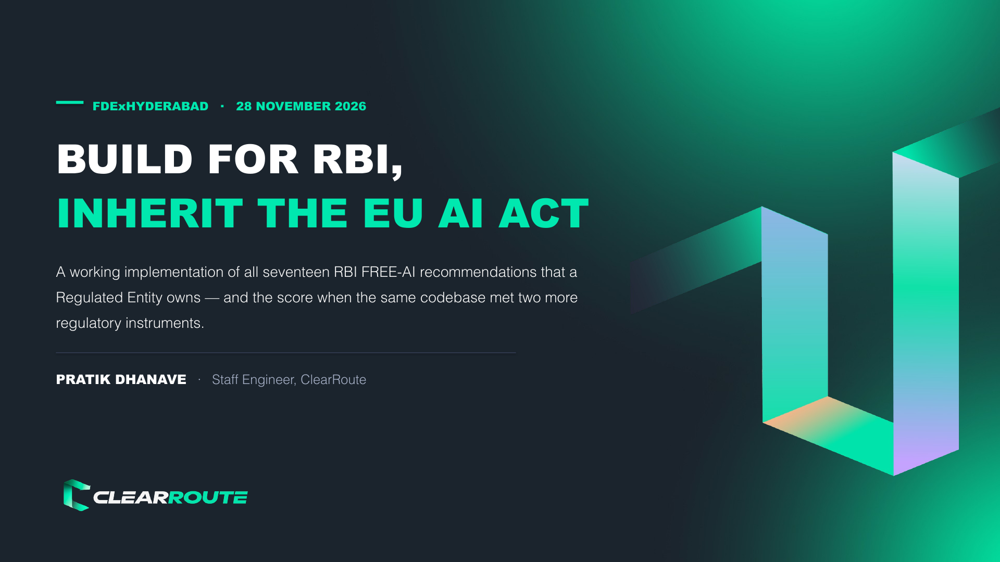
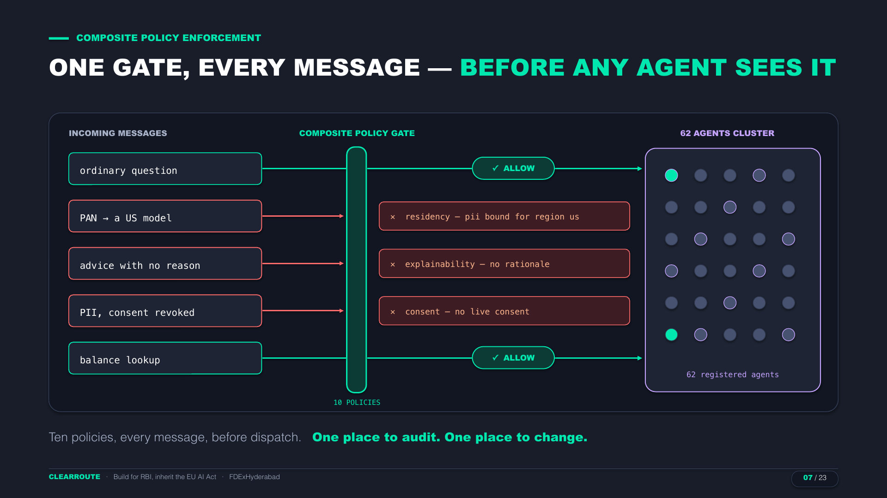
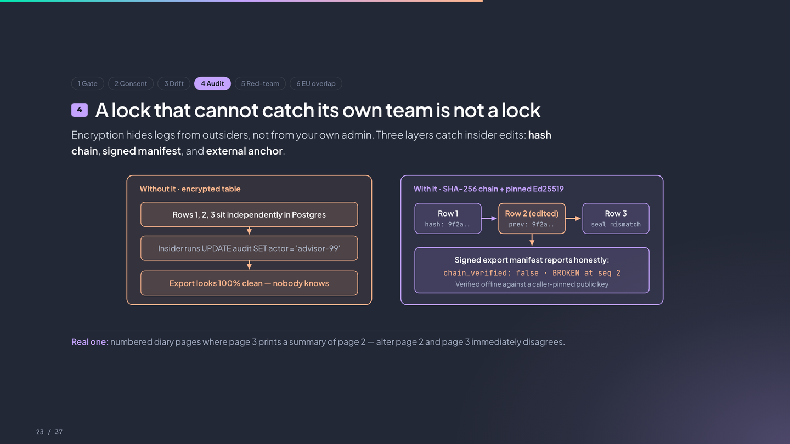
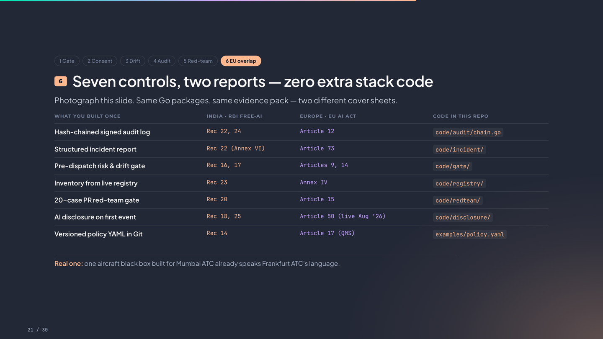
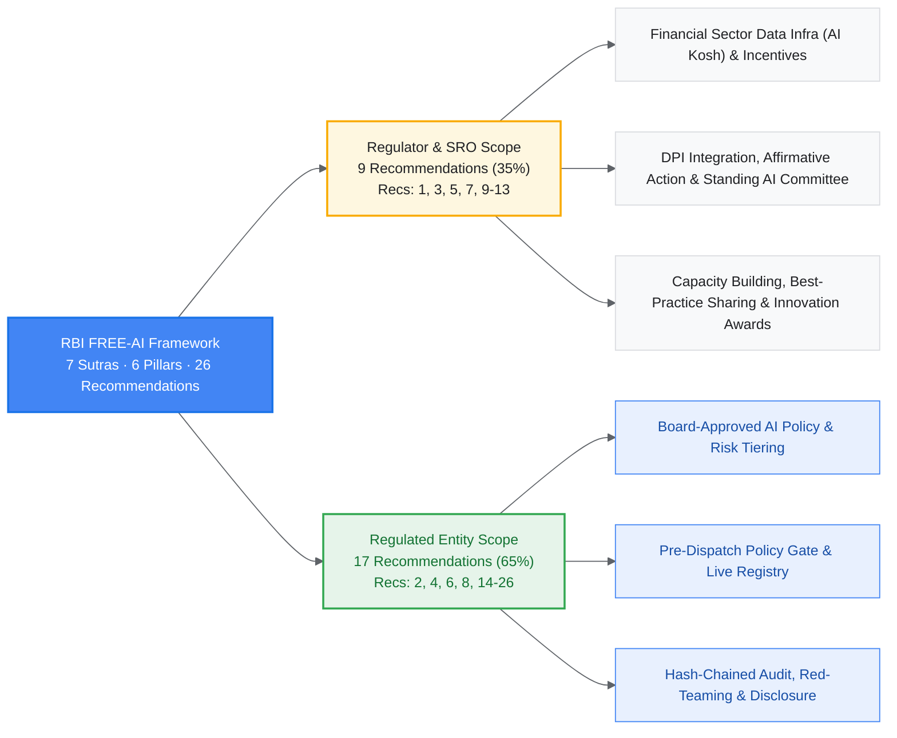
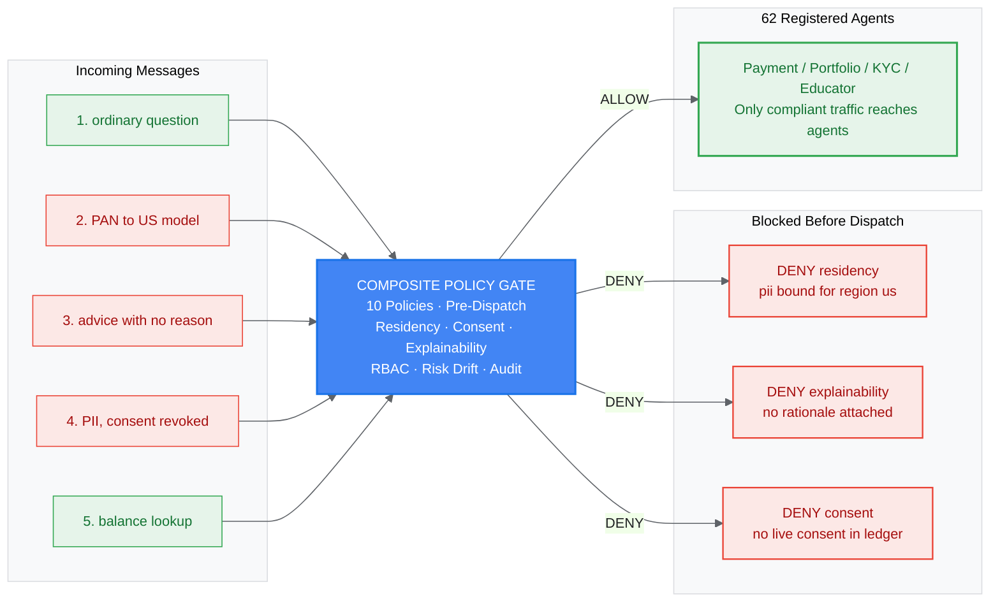
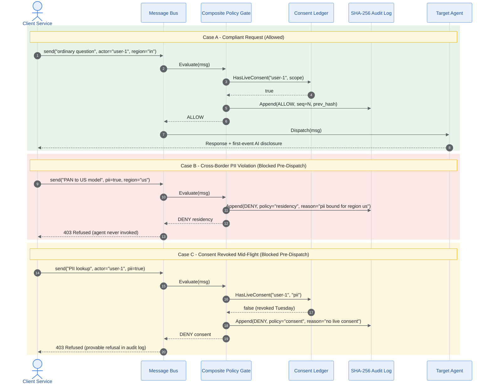
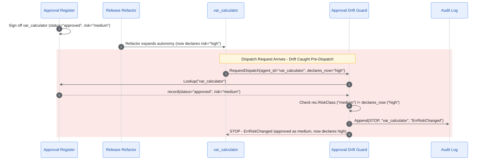
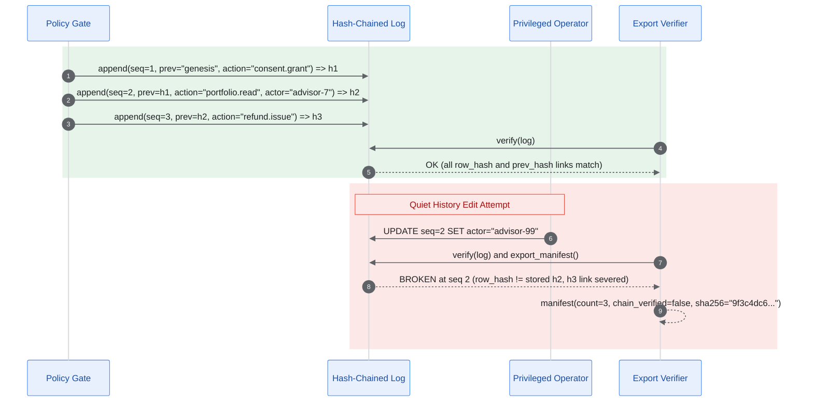
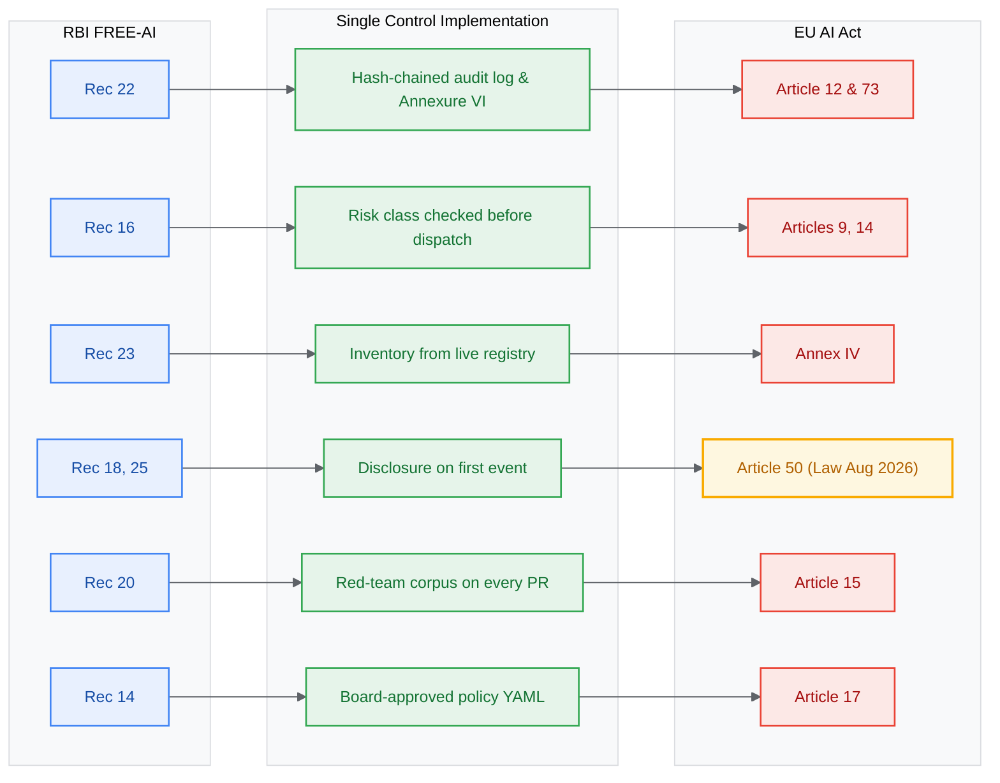

# Build for RBI, Inherit the EU AI Act

[](https://build-for-rbi-talk.vercel.app)
[](https://github.com/PratikDhanave/Build-For-RBI-Inherit-The-EU-AI-Act/actions/workflows/verify.yml)
[](https://build-for-rbi-talk.vercel.app)
[](#2-the-9--17-split-scoping-rbi-free-ai-correctly)
[](#6-regulatory-convergence-rbi-free-ai--eu-ai-act)
[](#7-the-binding-instrument-rbi-draft-model-risk-management-guidance)
[](./LICENSE)

> **What RBI FREE-AI asks of your codebase — and how much of the EU AI Act comes with it.**  
> Presented by **Pratik Dhanave** (Staff Engineer, ClearRoute) at **FDExHyderabad · 28 November 2026**.

### Deck Preview ([Open Interactive Web Deck →](https://build-for-rbi-talk.vercel.app))

| Cover (Slide 01) | Composite Policy Gate (Slide 08) |
| :---: | :---: |
| [](https://build-for-rbi-talk.vercel.app/#1) | [](https://build-for-rbi-talk.vercel.app/#8) |
| **Three Cryptographic Locks (Slide 18)** | **RBI ↔ EU AI Act Cross-Walk (Slide 22)** |
| [](https://build-for-rbi-talk.vercel.app/#18) | [](https://build-for-rbi-talk.vercel.app/#22) |

**Downloads & Playbooks:** [`build-for-rbi-ppt.pptx`](./build-for-rbi-ppt.pptx) · [`build-for-rbi-handout.pdf`](./build-for-rbi-handout.pdf) · [**Visual Diagram Atlas (25 Diagrams)**](./docs/DIAGRAMS.md) · [**Official RBI FREE-AI Report (PDF)**](https://rbidocs.rbi.org.in/rdocs/PublicationReport/Pdfs/FREEAIR130820250A24FF2D4578453F824C72ED9F5D5851.PDF) · [`17-Rec Traceability Matrix`](./docs/RBI-FREE-AI-17-MATRIX.md) · [`5-Min Vendor Checklist`](./docs/VENDOR-CHECKLIST.md) · [`SOW Deployer vs. Provider Guide`](./docs/SOW-DEPLOYER-VS-PROVIDER.md) · [`rbi-eu-ai-act.json`](./crosswalk/rbi-eu-ai-act.json) · [`rbi-eu-ai-act.csv`](./crosswalk/rbi-eu-ai-act.csv)

---

<details>
<summary><strong>Table of Contents</strong> (click to expand)</summary>

1. [The Short Version](#1-the-short-version)
   - [Beyond the 20-Minute Talk: Deep-Dive Companion Guides](#beyond-the-20-minute-talk-deep-dive-companion-guides)
2. [The 9 / 17 Split: Scoping RBI FREE-AI Correctly](#2-the-9--17-split-scoping-rbi-free-ai-correctly)
3. [Architecture: One Gate, Every Message](#3-architecture-one-gate-every-message)
4. [Message Sequence Diagrams](#4-message-sequence-diagrams)
   - [4.1 Pre-Dispatch Composite Policy Enforcement](#41-pre-dispatch-composite-policy-enforcement)
   - [4.2 Finding 1 — Runtime Approval Drift Detection (`ErrRiskChanged`)](#42-finding-1--runtime-approval-drift-detection-errriskchanged)
   - [4.3 Finding 2 — Tamper-Evident SHA-256 Audit Chain & Export Verification](#43-finding-2--tamper-evident-sha-256-audit-chain--export-verification)
5. [Code Snippets & Runnable Labs](#5-code-snippets--runnable-labs)
   - [5.1 The Five-Minute Offline Procurement Test](#51-the-five-minute-offline-procurement-test)
   - [5.2 Composite Policy Gate Pattern (Go)](#52-composite-policy-gate-pattern-go)
   - [5.3 Finding 1 — Runtime Risk-Drift Guard (Go)](#53-finding-1--runtime-risk-drift-guard-go)
   - [5.4 Lab 01 — Five Agents, One Bad Approval (`approval.go`)](#54-lab-01--five-agents-one-bad-approval-approvalgo)
   - [5.5 Lab 02 — Rewrite One Row, Watch It Fail (`audit.go`)](#55-lab-02--rewrite-one-row-watch-it-fail-auditgo)
   - [5.6 Board-Approved Policy-as-Config (`policy.yaml`)](#56-board-approved-policy-as-config-policyyaml)
6. [Regulatory Convergence: RBI FREE-AI ↔ EU AI Act](#6-regulatory-convergence-rbi-free-ai--eu-ai-act)
7. [The Binding Instrument: RBI Draft Model Risk Management Guidance](#7-the-binding-instrument-rbi-draft-model-risk-management-guidance)
8. [Two Open Engineering Problems (Gaps Named, Not Closed)](#8-two-open-engineering-problems-gaps-named-not-closed)
9. [Deployer vs. Provider: The Scoping Clause That Belongs in the SOW](#9-deployer-vs-provider-the-scoping-clause-that-belongs-in-the-sow)
10. [Using the Interactive Web Deck & PowerPoint](#10-using-the-interactive-web-deck--powerpoint)
11. [Author, QR Codes & Links](#author-qr-codes--links)

</details>

---

## 1. The Short Version

| Metric | Count | Meaning |
| --- | :---: | --- |
| **RBI FREE-AI (Regulated Entity)** | **17 / 17** | All 17 RE recommendations addressed — 100% Go executable technical core in [`code/`](./code) & [`labs/`](./labs) (9 Go packages + 4 standalone Go labs + Go WebAssembly deck runner) & organizational/process controls in [`docs/`](./docs) (full 127-package benchmark referenced in talk) |
| **EU AI Act Controls Inherited** | **7** | Controls built for RBI that directly answer EU AI Act Articles 9, 12, 14, 15, 17, 50, 73 & Annex IV |
| **RBI Draft MRM Gaps** | **2** | Named transparently against the 24 June 2026 Draft MRM guidance — not closed, not hidden |
| **Network Dependency** | **0** | Runs offline on a laptop — no cloud account, no API key, no network required |

### Where the Requirements Came From
These constraints came from regulated **Open Banking delivery across ADGM, DIFC, and SAMA** — not from reading policy PDFs:

- **`REG` — Residency, per message:** Not per deployment; you cannot fork the platform once per country.
- **`RISK` — Consent as an append-only ledger:** If a customer revokes consent on Tuesday, an in-flight request must fail — and the record must prove it failed for that exact reason.
- **`BANK` — An answer on demand:** Every partner bank can ask where their customer's data went, and *"encrypted at rest"* is not an answer.

> Three different stakeholders asked for those guarantees. **None of them could be satisfied by a slide.**

---

## Beyond the 20-Minute Talk: Deep-Dive Companion Guides

The slide deck at [build-for-rbi-talk.vercel.app](https://build-for-rbi-talk.vercel.app) is intentionally concise for a **20-minute conference talk**. This repository goes much deeper with full engineering guides, runnable Go controls & labs, and buyer playbooks:

| Companion Guide | What It Covers Beyond the Slides |
| --- | --- |
| **[Visual Architecture Atlas (25 Diagrams)](./docs/DIAGRAMS.md)** | 12 dedicated Google Cloud-styled diagrams (System Context, 3-Layer FREE-AI Taxonomy, Approval State Machine, Consent Sequence, ER Data Model, Go Class Diagram, CI Red-Team Gate, Incident Escalation, RFC-002 Options & Evidence Pipeline) |
| **[01 · Composite Policy Gate Architecture](./docs/deep-dive/01-composite-policy-gate-architecture.md)** | Why agent-level guardrails fail at 62 agents, the ordered 10-policy pre-dispatch pipeline, latency vs. LLM-as-a-judge trade-offs, and Git-governed YAML config |
| **[02 · All 26 RBI FREE-AI Recommendations](./docs/deep-dive/02-rbi-free-ai-26-breakdown.md)** | Complete 7 Sutras, 6 Pillars, and all 26 recommendations mapped row-by-row into the exact **9 Regulator/SRO** vs. **17 Regulated Entity** split |
| **[03 · Dual Evidence Packs (RBI + EU AI Act)](./docs/deep-dive/03-eu-ai-act-crosswalk-evidence-packs.md)** | Extraterritorial EU AI Act scope for Indian engineering teams, regulatory timeline, dual evidence-pack directory layout, and article-by-article mapping |
| **[04 · Production Hardening, Drift & Audit Anchoring](./docs/deep-dive/04-production-hardening-and-audit-trail.md)** | External RFC 3161 / WORM timestamp anchoring, Ed25519 manifest signing, scaling partitioned hash chains, and CI chaos drills |
| **[05 · Multi-Jurisdiction Open Banking Residency](./docs/deep-dive/05-open-banking-multi-jurisdiction-residency.md)** | Enforcing per-message residency across India (RBI/DPDP), ADGM, DIFC & SAMA from one codebase without forking deployments |
| **[06 · RBI Draft MRM Guidance (June 2026) Playbook](./docs/deep-dive/06-rbi-mrm-draft-2026-engineering-guide.md)** | Full readiness breakdown of the binding MRM draft + a 90-day engineering roadmap to close `RFC-001` & `RFC-002` |
| **[Complete 17-Rec Traceability Matrix](./docs/RBI-FREE-AI-17-MATRIX.md)** | Every Regulated Entity recommendation (`2, 4, 6, 8, 14–26`) linked to runnable code & tests |
| **[5-Minute AI Vendor Procurement Checklist](./docs/VENDOR-CHECKLIST.md)** | Printable 12-point RFP scorecard (*"A control nobody can run is a claim"*) |
| **[Deployer vs. Provider SOW Scoping Guide](./docs/SOW-DEPLOYER-VS-PROVIDER.md)** | EU AI Act Art. 25 decision flowchart + 5 concrete contract clauses before signing an SOW |
| **[Open Problem RFCs (`RFC-001` & `RFC-002`)](./docs/open-problems/)** | Deep dives into the two unclosed gaps: Operator-Triggered Kill Switch & 10-Year Retention vs. Zero-Drift Live Inventory |

---

## 2. The 9 / 17 Split: Scoping RBI FREE-AI Correctly

RBI published the [**FREE-AI** (*Framework for Responsible and Ethical Enablement of AI*) committee report (Official PDF)](https://rbidocs.rbi.org.in/rdocs/PublicationReport/Pdfs/FREEAIR130820250A24FF2D4578453F824C72ED9F5D5851.PDF) on **13 August 2025**: **7 Sutras · 6 Pillars · 26 Recommendations**.

Before quoting or scoping a regulated AI engagement, separate what the regulator owns from what the Regulated Entity must build:



> Quote for all 26 recommendations and you have priced the regulator's own roadmap. **17** is the actual engineering scope of a Regulated Entity engagement.

---

## 3. Architecture: One Gate, Every Message

Instead of scattering compliance checks across 62 individual agents, **every message traverses one Composite Policy Gate before dispatch**. Ten policies run deterministically before any agent ever sees the payload.



**One place to audit. One place to change.** When the next regulatory clause lands, it becomes a policy config change — not a 62-agent rewrite.

---

## 4. Message Sequence Diagrams

### 4.1 Pre-Dispatch Composite Policy Enforcement



---

### 4.2 Finding 1 — Runtime Approval Drift Detection (`ErrRiskChanged`)

An approval describes a system **as it was on the day it was signed**. When `var_calculator` is refactored from `medium` to `high` risk, nobody rejected or withdrew it — the approval register simply went stale. The gate catches that drift at dispatch time:



---

### 4.3 Finding 2 — Tamper-Evident SHA-256 Audit Chain & Export Verification

A control that cannot catch its own operator is not a control. Each audit entry binds `prev_hash` into its SHA-256 digest, and the signed export manifest **always reports whether verification held — including when it did not**.



---

## 5. Code Snippets & Runnable Labs

### 5.1 The Five-Minute Offline Procurement Test

A control nobody can run is a claim. It is a fair test to put to any AI vendor — and a fairer one to put to yourself:

```bash
# Run all standalone Go packages, Go labs & evidence-pack export (100% Go, zero dependencies, zero network):
git clone https://github.com/PratikDhanave/Build-For-RBI-Inherit-The-EU-AI-Act.git
cd Build-For-RBI-Inherit-The-EU-AI-Act
make demo   # runs code/scripts/offline_verify.sh (9 Go pkgs + cmd/demo + 4 Go labs + WASM tests + cmd/evidencepack)
make test   # runs all Go vet/race tests, Go lab assertions & cross-walk/Mermaid/asset verifier

# Full Go implementation benchmark referenced in Slide 12:
git clone <genie-repo> && cd genie
go test ./...        # -> 127 packages ok
go run ./cmd/genie   # -> full pipeline, sample CSV, ~30s
```

> Standalone Go files included in [`code/`](./code) & [`labs/`](./labs): [`code/cmd/demo/main.go`](./code/cmd/demo/main.go) (`go run ./cmd/demo`) · [`code/cmd/evidencepack/main.go`](./code/cmd/evidencepack/main.go) (`go run ./cmd/evidencepack`) · [`code/cmd/verify/main.go`](./code/cmd/verify/main.go) · [`code/cmd/serve/main.go`](./code/cmd/serve/main.go) · [`code/config/loader.go`](./code/config/loader.go) · [`code/consent/ledger.go`](./code/consent/ledger.go) · [`code/disclosure/disclosure.go`](./code/disclosure/disclosure.go) · [`code/gate/composite_gate.go`](./code/gate/composite_gate.go) · [`code/gate/approval_gate.go`](./code/gate/approval_gate.go) · [`code/audit/chain.go`](./code/audit/chain.go) *(with Ed25519 signing)* · [`code/incident/annexure_vi.go`](./code/incident/annexure_vi.go) · [`code/registry/registry.go`](./code/registry/registry.go) · [`code/redteam/corpus.json`](./code/redteam/corpus.json) *(tagged with OWASP ASI)* · [`labs/`](./labs) (`gate_demo`, `approval`, `audit`, `consent_ledger`, `wasm`) · [`code/scripts/offline_verify.sh`](./code/scripts/offline_verify.sh).

---

### 5.2 Composite Policy Gate Pattern (Go)

Every message passes through an ordered chain of deterministic policy checks before dispatch:

```go
package gate

import (
	"context"
	"fmt"
)

type Message struct {
	ActorID      string
	ActorRole    string
	SubjectID    string // Customer / data subject for PII consent checks
	AgentID      string
	Region       string
	ContainsPII  bool
	IsAdvice     bool
	Rationale    string
	ConsentLive  bool
	DeclaredRisk string
}

type Policy interface {
	Name() string
	Check(ctx context.Context, msg Message) error
}

type CompositeGate struct {
	Policies []Policy
	Audit    AuditLogger
}

func (g *CompositeGate) Allow(ctx context.Context, msg Message) error {
	for _, p := range g.Policies {
		if err := p.Check(ctx, msg); err != nil {
			if g.Audit != nil {
				_ = g.Audit.RecordDeny(msg, p.Name(), err.Error())
			}
			return fmt.Errorf("DENY [%s]: %w", p.Name(), err)
		}
	}
	if g.Audit != nil {
		if err := g.Audit.RecordAllow(msg); err != nil {
			return fmt.Errorf("DENY [audit]: failed recording allow decision: %w", err)
		}
	}
	return nil
}
```

---

### 5.3 Finding 1 — Runtime Risk-Drift Guard (Go)

From `approval_gate.go` — catching silent governance drift (RBI FREE-AI Rec 17):

```go
if rec.RiskClass != risk {
    return fmt.Errorf("%w: %s approved as %s, now declares %s",
        ErrRiskChanged, a.ID(), rec.RiskClass, risk)
}
```

---

### 5.4 Lab 01 — Five Agents, One Bad Approval (`approval.go`)

Interactive in **Slide 15** of [https://build-for-rbi-talk.vercel.app/#15](https://build-for-rbi-talk.vercel.app/#15) (press **`R`** or click a scenario chip to run live in browser via offline **Go WebAssembly**) or run locally via `go run labs/approval/main.go`:

**Expected Output:**

```text
RUN   payment_orchestrator   live
STOP  kyc_orchestrator       ErrExpired
STOP  aml_monitor            ErrNotApproved (rejected)
STOP  var_calculator         ErrRiskChanged (approved as medium, now declares high)
RUN   educator               low/medium — no approval required

var_calculator is the one I would have missed.
```

<details>
<summary>View full <code>approval.go</code> source (<a href="./labs/approval/main.go"><code>labs/approval/main.go</code></a>)</summary>

```go
package main

import (
	"fmt"
	"strings"
	"time"
)

type Record struct {
	Status  string
	Risk    string
	Expires *time.Time
}

var (
	now            = time.Date(2026, 11, 28, 10, 0, 0, 0, time.UTC)
	knownRiskTiers = map[string]bool{"low": true, "medium": true, "high": true}
	in60Days       = now.AddDate(0, 0, 60)
	yesterday      = now.AddDate(0, 0, -1)

	register = map[string]*Record{
		"payment_orchestrator": {Status: "approved", Risk: "high", Expires: &in60Days},
		"kyc_orchestrator":     {Status: "approved", Risk: "high", Expires: &yesterday},
		"aml_monitor":          {Status: "rejected", Risk: "high"},
		"var_calculator":       {Status: "approved", Risk: "medium"}, // signed off at medium
		"educator":             nil,                                  // never reviewed
	}
)

func allow(agentID, declaresNow string) (bool, string) {
	risk := strings.ToLower(strings.TrimSpace(declaresNow))
	if !knownRiskTiers[risk] {
		return false, fmt.Sprintf("ErrUnknownRisk (%q)", declaresNow)
	}
	if risk != "high" {
		return true, "low/medium — no approval required"
	}
	rec := register[agentID]
	if rec == nil {
		return false, "ErrNoApproval"
	}
	if strings.ToLower(strings.TrimSpace(rec.Status)) != "approved" {
		return false, fmt.Sprintf("ErrNotApproved (%s)", rec.Status)
	}
	if rec.Expires != nil && now.After(*rec.Expires) {
		return false, "ErrExpired"
	}
	if strings.ToLower(strings.TrimSpace(rec.Risk)) != risk {
		return false, fmt.Sprintf("ErrRiskChanged (approved as %s, now declares %s)", rec.Risk, risk)
	}
	return true, "live"
}

func main() {
	today := []struct{ id, risk string }{
		{"payment_orchestrator", "high"},
		{"kyc_orchestrator", "high"},
		{"aml_monitor", "high"},
		{"var_calculator", "high"},
		{"educator", "low"},
	}
	for _, a := range today {
		ok, why := allow(a.id, a.risk)
		status := "STOP"
		if ok {
			status = "RUN "
		}
		fmt.Printf("%s  %-22s %s\n", status, a.id, why)
	}
	fmt.Println("\nvar_calculator is the one I would have missed.")
}
```

</details>

---

### 5.5 Lab 02 — Rewrite One Row, Watch It Fail (`audit.go`)

Interactive in **Slide 19** of [https://build-for-rbi-talk.vercel.app/#19](https://build-for-rbi-talk.vercel.app/#19) (press **`R`** or click a scenario chip to run live in browser via offline **Go WebAssembly**) or run locally via `go run labs/audit/main.go`:

**Expected Output:**

```text
fresh chain           OK
after one edited row  BROKEN at seq 2 (row_hash)

export manifest       {"count":3,"chain_verified":false,"sha256":"695b0fd6ba224a064f8eeb50…"}

The export does not hide the break. It reports it.
```

<details>
<summary>View full <code>audit.go</code> source (<a href="./labs/audit/main.go"><code>labs/audit/main.go</code></a>)</summary>

```go
package main

import (
	"crypto/sha256"
	"encoding/hex"
	"encoding/json"
	"fmt"
	"strings"
)

type Entry struct {
	Seq      int    `json:"seq"`
	Actor    string `json:"actor"`
	Action   string `json:"action"`
	Target   string `json:"target"`
	PrevHash string `json:"prev_hash"`
	RowHash  string `json:"row_hash,omitempty"`
}

func rowHash(prev string, e Entry) string {
	e.RowHash = ""
	body, _ := json.Marshal(struct {
		Prev string `json:"prev"`
		Entry
	}{Prev: prev, Entry: e})
	sum := sha256.Sum256(body)
	return hex.EncodeToString(sum[:])
}

func appendLog(log *[]Entry, actor, action, target string) {
	prev := "genesis"
	if n := len(*log); n > 0 {
		prev = (*log)[n-1].RowHash
	}
	e := Entry{Seq: len(*log) + 1, Actor: actor, Action: action, Target: target, PrevHash: prev}
	e.RowHash = rowHash(prev, e)
	*log = append(*log, e)
}

func verify(log []Entry) (bool, int, string) {
	if len(log) == 0 {
		return false, 0, "empty_log"
	}
	prev := "genesis"
	for i, e := range log {
		if e.Seq != i+1 {
			return false, i + 1, "seq"
		}
		if e.PrevHash != prev {
			return false, e.Seq, "prev_hash"
		}
		if rowHash(prev, e) != e.RowHash {
			return false, e.Seq, "row_hash"
		}
		prev = e.RowHash
	}
	return true, 0, ""
}

func main() {
	var log []Entry
	appendLog(&log, "system", "consent.grant", "user-1")
	appendLog(&log, "advisor-7", "portfolio.read", "user-1")
	appendLog(&log, "payment_orch", "refund.issue", "txn-9931")

	ok, seq, field := verify(log)
	fmt.Println("fresh chain          ", statusText(ok, seq, field))

	log[1].Actor = "advisor-99" // someone edits history
	ok, seq, field = verify(log)
	fmt.Println("after one edited row ", statusText(ok, seq, field))

	lines := make([]string, len(log))
	for i, e := range log {
		b, _ := json.Marshal(e)
		lines[i] = string(b)
	}
	sum := sha256.Sum256([]byte(strings.Join(lines, "\n")))
	manifest, _ := json.Marshal(struct {
		Count         int    `json:"count"`
		ChainVerified bool   `json:"chain_verified"`
		SHA256        string `json:"sha256"`
	}{len(log), ok, hex.EncodeToString(sum[:])[:24] + "…"})
	fmt.Printf("\nexport manifest       %s\n\nThe export does not hide the break. It reports it.\n", manifest)
}
```

</details>

---

### 5.6 Board-Approved Policy-as-Config (`policy.yaml`)

Declarative governance configuration answering both **RBI FREE-AI Rec 14** and **EU AI Act Article 17** so new regulatory clauses are config updates rather than code rewrites (excerpt matching [`code/config/policy.yaml`](./code/config/policy.yaml), parsed directly by [`code/config/loader.go`](./code/config/loader.go)):

```yaml
version: "2026.11"
approved_by: "board-risk-committee@bank"
effective_date: "2026-11-28"
review_cycle_days: 90

policies:
  residency:
    enabled: true
    enforce_per_message: true
    pii_allowed_regions:
      - "in"
      - "adgm"
      - "difc"
      - "sama"
    deny_regions:
      - "us"
    fail_closed: true

  consent:
    enabled: true
    ledger_mode: "append-only"
    fail_in_flight_on_revocation: true

  explainability:
    enabled: true
    require_rationale_for:
      - "advice"
      - "credit_decision"
      - "loan_decision"
      - "portfolio_rebalance"

  approval_drift:
    enabled: true
    high_risk_requires_active_signoff: true
    block_on_risk_class_change: true # ErrRiskChanged (Rec 17)

  disclosure:
    enabled: true
    emit_on_first_event: true # RBI Rec 18/25 & EU AI Act Art 50

  audit:
    enabled: true
    hash_algorithm: "sha256"
    anchor_external_timestamp: true
    report_broken_chain_in_manifest: true
```

---

## 6. Regulatory Convergence: RBI FREE-AI ↔ EU AI Act

The EU AI Act reaches you **the moment your output is used in Europe** — regardless of where the system was engineered. Regulators converge because there are only so many ways to make an automated system accountable.

> **2026 Enforcement Note (`Regulation (EU) 2026/1744`, Digital Omnibus on AI & India 2026 Overlays):** **EU Article 50 transparency** is binding law since **2 August 2026** (legacy watermarking grace ends **2 Dec 2026**), while standalone **Annex III High-Risk AI** & **Art. 27 FRIA** deadlines shifted to **2 December 2027**. In India, **DPDP Rules Rule 4 (Consent Managers)** went live **13 November 2026** (full enforcement **13 May 2027**), and **MeitY IT Amendment Rules, 2026** (effective **20 February 2026**) mandate audio/visual labels & provenance on Synthetically Generated Information (SGI). Full timeline in [Deep Dive 03](./docs/deep-dive/03-eu-ai-act-crosswalk-evidence-packs.md) & [Deep Dive 05](./docs/deep-dive/05-open-banking-multi-jurisdiction-residency.md).



### Reusable Cross-Walk (One Implementation, Two Evidence Packs)

> **Machine-readable exports for Jira, Confluence, or GRC ingestion:** [`crosswalk/rbi-eu-ai-act.json`](./crosswalk/rbi-eu-ai-act.json) · [`crosswalk/rbi-eu-ai-act.csv`](./crosswalk/rbi-eu-ai-act.csv)

| Control Implemented | RBI FREE-AI | EU AI Act |
| --- | --- | --- |
| Hash-chained audit log | `Rec 22` | `Article 12` |
| Annexure VI incident form *(RBI's prescribed AI-incident report)* | `Rec 22` | `Article 73` |
| Risk class checked before dispatch | `Rec 16` | `Articles 9, 14` |
| Inventory from the live registry | `Rec 23` | `Annex IV` |
| Red-team corpus on every PR | `Rec 20` | `Article 15` |
| Disclosure on the first event | `Rec 18, 25` | `Article 50` *(law since 2 Aug 2026)* |
| Board-approved policy YAML | `Rec 14` | `Article 17` |

---

## 7. The Binding Instrument: RBI Draft Model Risk Management Guidance

FREE-AI is an advisory committee report. The instrument that will actually bind regulated entities across **11 categories of REs** (covering statistical, ML, GenAI, foundation, and third-party vendor models — including client-side kill-switch accountability) is the **RBI Draft Model Risk Management (MRM) Guidance** — see [Deep Dive 06: RBI Draft MRM Playbook](./docs/deep-dive/06-rbi-mrm-draft-2026-engineering-guide.md):

- **24 June 2026:** Issued for public consultation
- **24 July 2026:** Industry comments closed
- **Pending:** Final binding circular

### Honest Scorecard Against the Draft

| What the RBI Draft MRM Guidance Requires | Status |
| --- | :---: |
| Board-approved model risk framework | ✅ **Built** |
| Full model inventory, nothing running outside it | ✅ **Built** |
| Risk tiering by materiality, complexity and autonomy | ✅ **Built** |
| Accountable for a vendor's model, certified or not | ✅ **Built** |
| Mandatory AI kill switch (operator-triggered stop) | ⚠️ **Gap** |
| Inventory kept 10 years, including decommissioned models | ⚠️ **Gap** |

---

## 8. Two Open Engineering Problems (Gaps Named, Not Closed)

Naming your gaps buys more credibility in an architectural or regulatory review than claiming full coverage ever has:

1. **Gap 01 — Mandatory AI Kill Switch** — Read full RFC: [`docs/open-problems/RFC-001-ai-kill-switch.md`](./docs/open-problems/RFC-001-ai-kill-switch.md)
   - We already have circuit breakers, deadlines, budget caps, and deterministic fallbacks.
   - A mandated kill switch requires an **operator-triggered hard stop** with guaranteed propagation across active sessions. Adjacent — not the same thing.
   - *Industry reference:* [CrowdStrike Falcon Guardian AI Kill Switch (Nov 2026)](https://www.crowdstrike.com/en-us/blog/crowdstrike-introduces-ai-kill-switch/) — real-world 4-layer pattern (AI gateway model cut-off, root process termination, relaunch prevention, network isolation).
2. **Gap 02 — Ten-Year Retention vs. Zero-Drift Live Inventory** — Read full RFC: [`docs/open-problems/RFC-002-ten-year-retention.md`](./docs/open-problems/RFC-002-ten-year-retention.md)
   - The current inventory reads the **live registry** directly, so it **cannot drift** from what is actually running in production.
   - The draft requires retaining decommissioned models for **10 years**.
   - **Architectural conflict:** *A live inventory cannot drift, and cannot remember.*

> Have a production pattern for either gap? [**Submit an Open Problem Proposal →**](https://github.com/PratikDhanave/Build-For-RBI-Inherit-The-EU-AI-Act/issues/new?template=open-problem-proposal.md)

---

## 9. Deployer vs. Provider: The Scoping Clause That Belongs in the SOW

Under the EU AI Act, you can accidentally move your customer from **deployer** to **provider** without telling them:

| Scenario | Customer Classification | Where Heavy Legal Duties Land |
| --- | --- | --- |
| You install your configured agent under **your name**; they operate it | **Still a Deployer** | Duties stay largely with **you (the vendor)** |
| You **fine-tune** the model on their data, or ship it under **their brand** | **Now a Provider** | Substantially modified / placed into service under own name — **heavier duties shift to the client** |

> That difference belongs in the **SOW** — a scoping conversation, not a post-mortem. See the full [Deployer vs. Provider SOW Scoping Guide](./docs/SOW-DEPLOYER-VS-PROVIDER.md) for the Art. 25 decision flowchart and 5 sample contract clauses.

---

## 10. Using the Interactive Web Deck & PowerPoint

### Repository Structure

```text
.
├── index.html                           # 31-slide ClearRoute 4-Act storytelling web deck (23 animated SVGs, 2 live Go WASM labs + 3 Q&A backups)
├── assets/                              # Brand/QR assets + compiled Go WebAssembly (`labs.wasm`, `wasm_exec.js`)
├── build-for-rbi-ppt.pptx               # ClearRoute 2026 PowerPoint deck (23 talk + 3 Q&A backup slides, 20" × 11.25")
├── build-for-rbi-handout.pdf            # Print-ready 26-slide PDF handout (23 talk + 3 Q&A backup slides)
├── code/                                # 100% Go governance modules & CLIs (zero external dependencies)
│   ├── go.mod                           # Zero-dependency Go module
│   ├── cmd/demo/main.go                 # One-command offline CLI pipeline (`go run ./cmd/demo`)
│   ├── cmd/evidencepack/main.go         # Dual RBI + EU AI Act evidence-pack exporter (`go run ./cmd/evidencepack`)
│   ├── cmd/verify/main.go               # Pure-Go cross-walk, YAML parity, Mermaid & asset verifier
│   ├── cmd/serve/main.go                # Pure-Go local static server with `application/wasm` MIME support
│   ├── config/                          # Board-approved `policy.yaml` + zero-dep Go YAML loader (Rec 14 / Art 17)
│   ├── consent/                         # Append-only Consent Ledger with Tuesday revocation proof (Rec 15)
│   ├── disclosure/                      # First-event AI disclosure tracker (Rec 18, 25 / Art 50)
│   ├── gate/                            # Composite Policy Gate & ErrRiskChanged drift guard (Go)
│   ├── audit/                           # SHA-256 hash chain + Ed25519 signed manifest export (Rec 22 / Art 12)
│   ├── incident/                        # RBI Annexure VI / EU AI Act Art 73 generator (Go)
│   ├── registry/                        # Zero-drift live agent registry exporter (Rec 23 / Annex IV)
│   ├── redteam/                         # 20-case OWASP ASI adversarial red-team corpus run on every PR (Rec 20 / Art 15)
│   └── scripts/offline_verify.sh        # One-command pure-Go zero-network verification script
├── examples/
│   ├── policy.yaml                      # Board-approved policy YAML
│   ├── annexure-vi-sample.json          # Sample RBI Annexure VI / EU AI Act Art 73 incident report
│   └── inventory-export.json            # Sample live registry inventory export (Rec 23 / Annex IV)
├── docs/
│   ├── DIAGRAMS.md                      # Visual Architecture Atlas (12 dedicated diagrams; 25 total across repo)
│   ├── deep-dive/                       # Full companion guides expanding beyond the 20-min talk (01–06)
│   ├── RBI-FREE-AI-17-MATRIX.md         # Full 17-recommendation traceability matrix
│   ├── VENDOR-CHECKLIST.md              # Printable 5-minute AI vendor procurement scorecard
│   ├── SOW-DEPLOYER-VS-PROVIDER.md      # Deployer vs. Provider SOW scoping guide + diagram
│   ├── qr-live-deck.png & qr-repo.png   # Conference QR codes for live deck & repository
│   ├── screenshots/                     # Slide preview renders embedded in README
│   └── open-problems/                   # Architecture RFCs (`RFC-001` Kill Switch, `RFC-002` Retention)
├── crosswalk/                           # Machine-readable JSON & CSV regulatory cross-walks
├── labs/                                # Standalone Go labs (`gate_demo`, `approval`, `audit`, `consent_ledger`) + `wasm/`
├── .github/                             # CI workflow (`verify.yml`) + RFC issue template
├── LICENSE, CONTRIBUTING.md, SECURITY.md
├── Makefile                             # make demo | make test | make wasm | make serve
└── README.md
```

### Run the Web Deck Locally (Offline)

```bash
git clone https://github.com/PratikDhanave/Build-For-RBI-Inherit-The-EU-AI-Act.git
cd Build-For-RBI-Inherit-The-EU-AI-Act
make serve   # pure-Go server on http://localhost:8000 (enables live offline Go WebAssembly labs)
```

### Keyboard Shortcuts

| Key | Action |
| --- | --- |
| `←` / `→` / `Space` | Navigate slides |
| `O` | Toggle slide overview grid |
| `S` | Toggle speaker notes drawer |
| `R` | Run live offline Go WebAssembly lab or replay active SVG diagram |
| `H` | Toggle bottom keyboard-hints bar (auto-hidden in fullscreen) |
| `A` | Toggle step-by-step build animations |
| `F` | Toggle fullscreen |
| `T` | Toggle ClearRoute dark / light theme |

### Full Slide Map (28 Talk Slides + 3 Q&A Backup Slides · 4-Act Storytelling)

| # | Slide | Theme | # | Slide | Theme |
| :-: | --- | --- | :-: | --- | --- |
| 01 | Build for RBI, inherit the EU AI Act | Hero Mint | 17 | 📓 Sealed Numbered Diary Pages *(Real-Life SVG)* | Deep Slate |
| 02 | Huge Shoutout (FDExHyderabad Operations Team) | Mint | 18 | Three Cryptographic Locks *(3-Lock Logger SVG)* | Deep Slate |
| 03 | The Ending, Up Front (`17 / 7 / 2` *Ring SVG*) | Deep Slate | 19 | Lab 02: `audit.go` *(Go WASM + Scenario Chips)* | Deep Slate |
| 04 | Act I: Three Knocks on Our Door *(Blueprint SVG)* | Deep Slate | 20 | ✈ Hyderabad → Frankfurt, One Black Box *(Real-Life SVG)* | Deep Slate |
| 05 | 🛂 Borders & 2:00 PM Revoke *(Real-Life SVG)* | Deep Slate | 21 | Build 17 for India — Inherit 7 for Europe *(Funnel SVG)* | Deep Slate |
| 06 | 26 RBI Rules Filtered (`9 vs 17` *Tile SVG*) | Deep Slate | 22 | Photograph This: 7 Controls, 2 Proof Packs | Lavender |
| 07 | ✈ Airport Authority vs. Airline *(Real-Life SVG)* | Deep Slate | 23 | Honest Score vs. Binding MRM (`4 Built / 2 Gaps`) | Peach |
| 08 | Act II: 62 In-Agent vs. One Go Gate *(Compare SVG)* | Deep Slate | 24 | 🔌 Pull the Plug & 10-Yr Graveyard *(Real-Life SVG)* | Deep Slate |
| 09 | ✈ 62 Planes, One Security Checkpoint *(Real-Life SVG)* | Deep Slate | 25 | Two Open Engineering Trade-Offs *(Tension SVG)* | Deep Slate |
| 10 | Go `<1 ms` vs. AI Judge *(Animated Chart SVG)* | Deep Slate | 26 | ⚡ The Invisible Legal Tripwire *(Real-Life SVG)* | Deep Slate |
| 11 | The Whole System, On One Slide *(Tracer SVG)* | Deep Slate | 27 | User vs. Maker: Decide Before Signing *(Shield SVG)* | Deep Slate |
| 12 | Rule Zero: Prove It Offline (`make demo` + Badges) | Mint | 28 | Epilogue: Take This Monday & Large QR Codes | Hero Mint |
| 13 | 🛵→🚛 Act III: Scooter License vs. Truck *(Real-Life SVG)* | Deep Slate | 29 | Q&A 01: AI Kill Switch — 3 Tiers, 4 Layers *(SVG)* | Deep Slate |
| 14 | Silent Approval Drift *(Inspection HUD SVG)* | Deep Slate | 30 | Q&A 02: One `policy.yaml`, Five Regions *(SVG)* | Deep Slate |
| 15 | Lab 01: `approval.go` *(Go WASM + Scenario Chips)* | Deep Slate | 31 | Q&A 03: Stopping Top 4 OWASP AI Attacks *(SVG)* | Deep Slate |
| 16 | Bug #2: Manifesto *(Diamond Breather)* | Mint | | | |

---

## Author, QR Codes & Links

| Scan for Live Web Deck | Scan for GitHub Repository |
| :---: | :---: |
|  |  |
| [build-for-rbi-talk.vercel.app](https://build-for-rbi-talk.vercel.app) | [Build-For-RBI-Inherit-The-EU-AI-Act](https://github.com/PratikDhanave/Build-For-RBI-Inherit-The-EU-AI-Act) |

- **Pratik Dhanave** — Staff Engineer, ClearRoute
- **Live Talk Deck:** https://build-for-rbi-talk.vercel.app
- **Official RBI FREE-AI Report (13 Aug 2025):** [Download PDF](https://rbidocs.rbi.org.in/rdocs/PublicationReport/Pdfs/FREEAIR130820250A24FF2D4578453F824C72ED9F5D5851.PDF)
- **AI Kill Switch Industry Reference (3 Nov 2026):** [CrowdStrike Introduces AI Kill Switch](https://www.crowdstrike.com/en-us/blog/crowdstrike-introduces-ai-kill-switch/)
- **Website:** https://pratikdhanave.com
- **LinkedIn:** https://linkedin.com/in/pratikdhanave
- **GitHub:** https://github.com/PratikDhanave
- **License:** [MIT](./LICENSE) · [Contributing](./CONTRIBUTING.md) · [Security](./SECURITY.md)
