# Visual Architecture Atlas — Regulated AI Governance Diagrams

> Visual companion to [**Build for RBI, Inherit the EU AI Act**](../README.md). Every diagram uses the **Google Cloud color palette** and **Google Sans / Roboto / Roboto Mono** typography, verified against Mermaid v11.

### Color Legend
- **Blue (`#4285F4`)** — Policy Gate, Core Infrastructure, RBI Controls, Runtime Modules
- **Green (`#34A853`)** — Allowed Flows, Verified States, Regulated Entity Scope, Built Controls
- **Yellow/Amber (`#F9AB00`)** — Reviews, Regulator/SRO Scope, Drift Warnings, Pending Milestones
- **Red (`#EA4335`)** — Blocked/Denied Flows, Tamper Alerts, EU AI Act Obligations, Open Gaps

---

## Table of Diagrams

1. [End-to-End System Context Architecture](#1-end-to-end-system-context-architecture)
2. [RBI FREE-AI Complete 3-Layer Taxonomy (7 Sutras · 6 Pillars · 9/17 Split)](#2-rbi-free-ai-complete-3-layer-taxonomy)
3. [Agent Governance Approval Lifecycle State Machine](#3-agent-governance-approval-lifecycle-state-machine)
4. [Append-Only Consent Ledger & In-Flight Revocation Sequence](#4-append-only-consent-ledger--in-flight-revocation-sequence)
5. [Cryptographic Audit Chain, Ed25519 Manifest & TSA Anchoring](#5-cryptographic-audit-chain-ed25519-manifest--tsa-anchoring)
6. [Governance & Compliance Data Model (ER Diagram)](#6-governance--compliance-data-model-er-diagram)
7. [Go Governance Packages & Interfaces (Class Diagram)](#7-go-governance-packages--interfaces-class-diagram)
8. [First-Event AI Disclosure Session Flow (RBI Rec 18, 25 / EU Art 50)](#8-first-event-ai-disclosure-session-flow)
9. [CI/CD Pull Request Red-Team & Governance Gate](#9-cicd-pull-request-red-team--governance-gate)
10. [Incident Escalation: RBI Annexure VI ↔ EU AI Act Article 73](#10-incident-escalation-rbi-annexure-vi--eu-ai-act-article-73)
11. [RFC-002 Architecture Options: 10-Year Retention vs. Zero-Drift](#11-rfc-002-architecture-options-10-year-retention-vs-zero-drift)
12. [Dual Evidence Pack Assembly Pipeline (`cmd/evidencepack`)](#12-dual-evidence-pack-assembly-pipeline)

*(Plus 13 additional diagrams in [`README.md`](../README.md), [`docs/deep-dive/`](./deep-dive), [`docs/SOW-DEPLOYER-VS-PROVIDER.md`](./SOW-DEPLOYER-VS-PROVIDER.md), and [`RFC-001`](./open-problems/RFC-001-ai-kill-switch.md).)*

---

## 1. End-to-End System Context Architecture

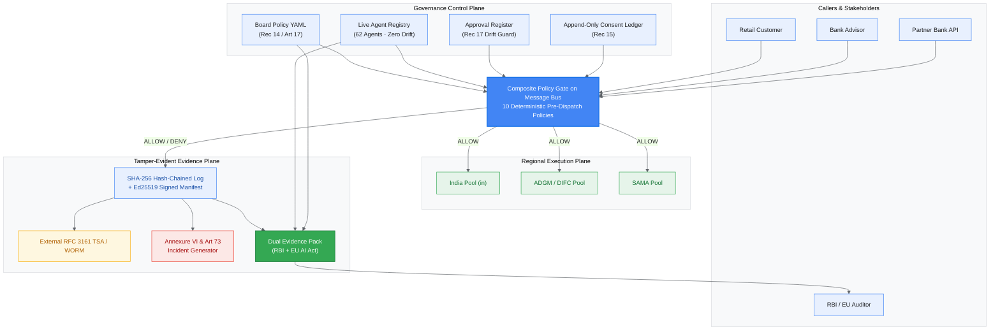

---

## 2. RBI FREE-AI Complete 3-Layer Taxonomy

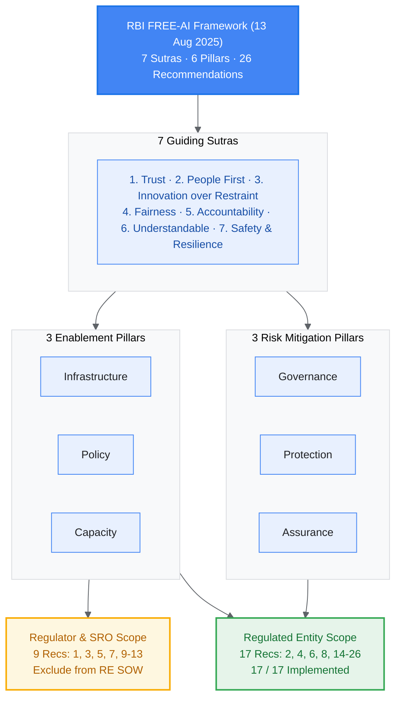

---

## 3. Agent Governance Approval Lifecycle State Machine

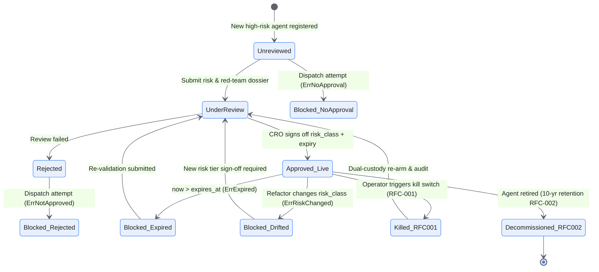

---

## 4. Append-Only Consent Ledger & In-Flight Revocation Sequence

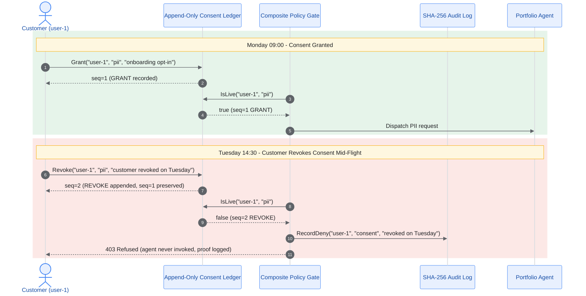

---

## 5. Cryptographic Audit Chain, Ed25519 Manifest & TSA Anchoring

```mermaid
%%{init: {"theme": "base", "themeVariables": {"fontFamily": "Google Sans, Roboto, Helvetica Neue, Arial, sans-serif", "fontSize": "14px", "primaryColor": "#E8F0FE", "primaryTextColor": "#202124", "primaryBorderColor": "#4285F4", "lineColor": "#5F6368"}}}%%
flowchart LR
    B1["seq 1 · genesis<br/>consent.grant<br/>row_hash: h1"] -->|"prev=h1"| B2["seq 2 · TAMPERED<br/>actor edited to #99<br/>hash mismatch!"]
    B2 -.->|"BROKEN LINK"| B3["seq 3 · INVALID<br/>refund.issue<br/>prev != recomputed h2"]
    B3 -.->|"BROKEN LINK"| B4["seq 4 · INVALID<br/>export.sign<br/>chain severed"]

    B4 --> VER["Verify() Walk<br/>ok=false, broken_at_seq=2<br/>field=row_hash"]
    VER --> MAN["Ed25519 SignedManifest<br/>chain_verified: false<br/>signature_valid: true"]
    MAN --> TSA["External RFC 3161 TSA<br/>or WORM Bucket Anchor"]

    style B1 fill:#E6F4EA,stroke:#34A853,stroke-width:2px,color:#137333
    style B2 fill:#FCE8E6,stroke:#EA4335,stroke-width:2.5px,color:#A50E0E
    style B3 fill:#FCE8E6,stroke:#EA4335,color:#A50E0E
    style B4 fill:#FCE8E6,stroke:#EA4335,color:#A50E0E
    style VER fill:#FEF7E0,stroke:#F9AB00,color:#B06000
    style MAN fill:#E8F0FE,stroke:#4285F4,stroke-width:2px,color:#174EA6
    style TSA fill:#4285F4,stroke:#1A73E8,color:#FFFFFF
```

---

## 6. Governance & Compliance Data Model (ER Diagram)

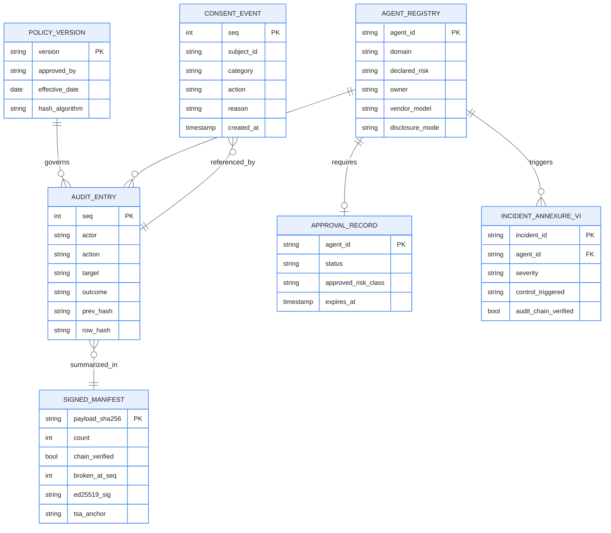

---

## 7. Go Governance Packages & Interfaces (Class Diagram)

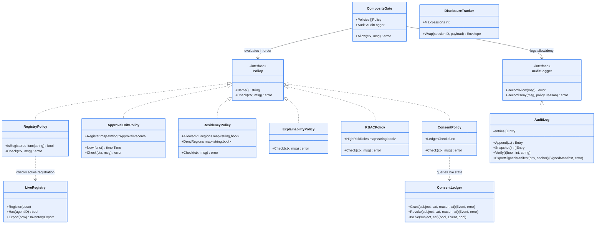

---

## 8. First-Event AI Disclosure Session Flow

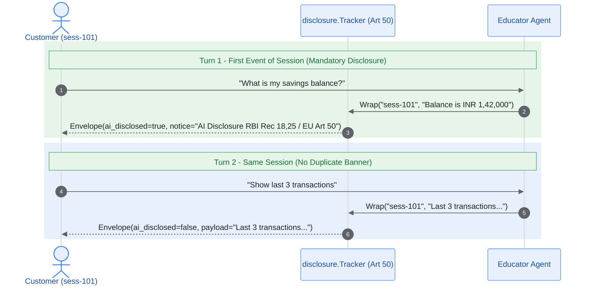

---

## 9. CI/CD Pull Request Red-Team & Governance Gate

```mermaid
%%{init: {"theme": "base", "themeVariables": {"fontFamily": "Google Sans, Roboto, Helvetica Neue, Arial, sans-serif", "fontSize": "14px", "primaryColor": "#E8F0FE", "primaryTextColor": "#202124", "primaryBorderColor": "#4285F4", "lineColor": "#5F6368"}}}%%
flowchart LR
    PR["Pull Request Opened"] --> VET["go vet & go test<br/>All 9 Go Packages"]
    VET --> RT["20-Case Red-Team Corpus<br/>RT-01..RT-20 (Rec 20 / Art 15)"]
    RT --> PY["4 Python Labs<br/>Gate · Drift · Audit · Consent"]
    PY --> XW["Cross-Walk & YAML Check<br/>JSON · CSV · policy.yaml"]
    XW --> MMD["Mermaid & Web Deck Lint<br/>index.html + Diagrams"]
    MMD --> PASS["CI Green Badge<br/>Auto-Deploy to Vercel"]

    RT -.->|"Any bypass fails PR"| FAIL["Block Merge"]

    style PR fill:#F8F9FA,stroke:#5F6368,color:#202124
    style VET fill:#E8F0FE,stroke:#4285F4,color:#174EA6
    style RT fill:#FEF7E0,stroke:#F9AB00,stroke-width:2px,color:#B06000
    style PY fill:#E8F0FE,stroke:#4285F4,color:#174EA6
    style XW fill:#E8F0FE,stroke:#4285F4,color:#174EA6
    style MMD fill:#E8F0FE,stroke:#4285F4,color:#174EA6
    style PASS fill:#34A853,stroke:#137333,color:#FFFFFF
    style FAIL fill:#FCE8E6,stroke:#EA4335,color:#A50E0E
```

---

## 10. Incident Escalation: RBI Annexure VI ↔ EU AI Act Article 73

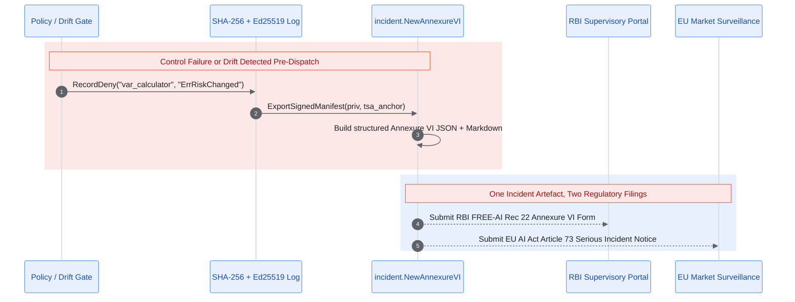

---

## 11. RFC-002 Architecture Options: 10-Year Retention vs. Zero-Drift

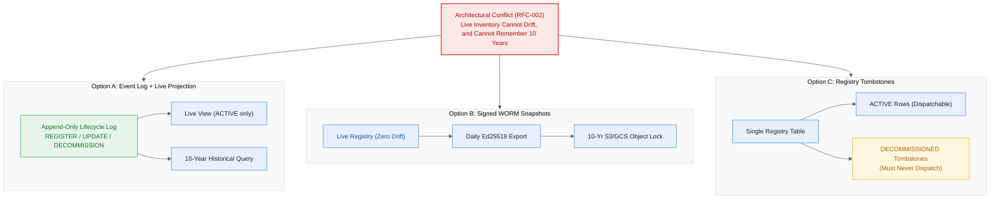

---

## 12. Dual Evidence Pack Assembly Pipeline

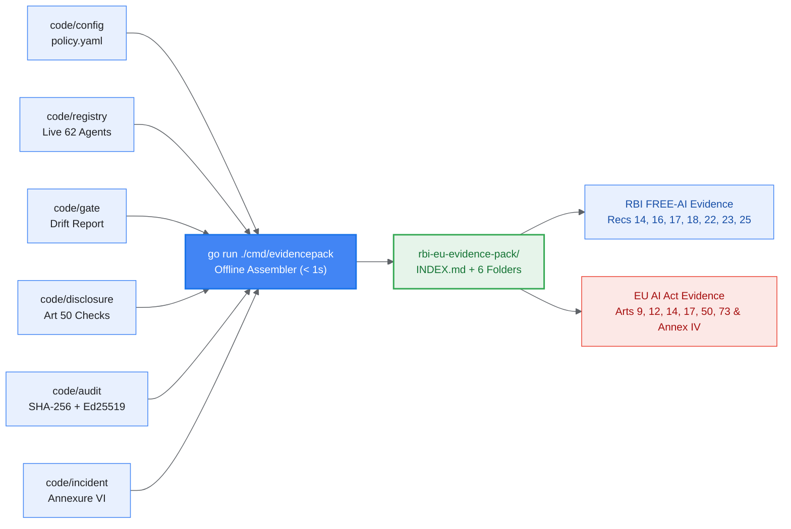
