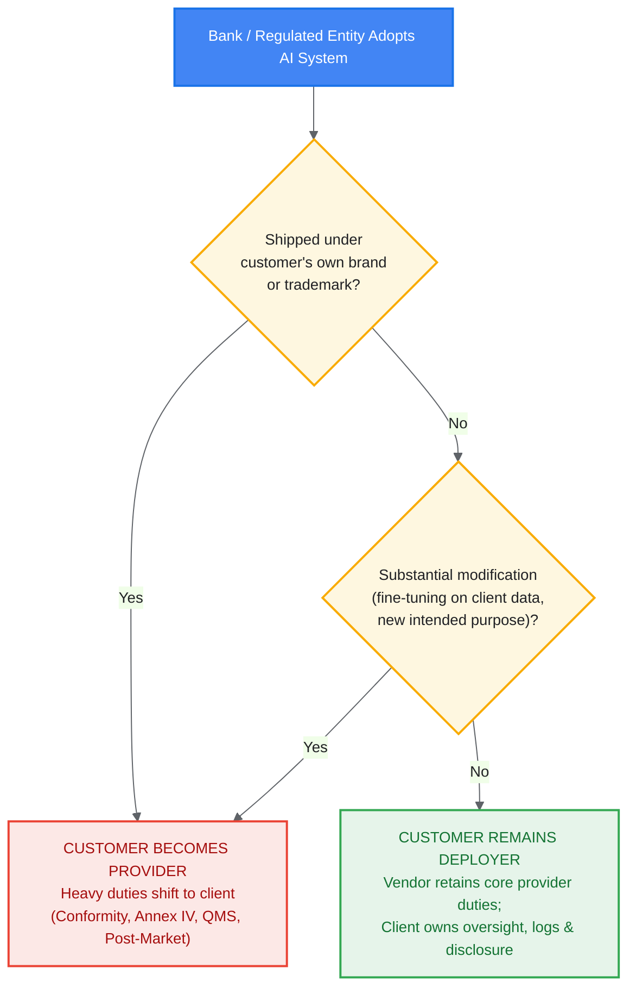

# Deployer vs. Provider — SOW Scoping Guide

> *"You can move your customer from deployer to provider without telling them. That difference belongs in the SOW — scoping conversation, not post-mortem."*  
> Reference: [Slide 21](https://build-for-rbi-talk.vercel.app/#21) · EU AI Act Article 25

---

## 1. Decision Flow (Google Cloud Styled)

---

## 2. Engineering Actions That Trigger Role Reclassification

| Engineering Activity | Likely Classification | Why It Matters |
| --- | --- | --- |
| Installing vendor's agent with standard YAML policy configuration under vendor's name | **Deployer** | Configuration within intended purpose does not constitute substantial modification |
| Adding RAG over customer documents without changing model weights or intended purpose | **Usually Deployer** *(confirm in SOW)* | Document carefully whether retrieval alters high-risk decision boundaries |
| **Fine-tuning** weights on customer's proprietary credit/transaction data | **Provider** | Considered substantial modification; full provider obligations transfer to the customer |
| **White-labeling** the AI assistant under the bank's own brand/trademark | **Provider** | Putting a high-risk system into service under own name triggers EU AI Act Art. 25 |
| Repurposing a general-purpose or low-risk assistant into credit scoring / KYC underwriting | **Provider** | Changing intended purpose into a high-risk category transfers provider responsibility |

---

## 3. Critical Banking Caveat: What Still Stays With a Pure Deployer (Articles 26 & 27)

Staying classified as a **Deployer** does **not** mean zero EU AI Act obligations for a financial institution:
- **Article 27 — Mandatory Fundamental Rights Impact Assessment (FRIA):** Banks and insurers deploying **Annex III(5)(b)/(c)** high-risk AI (**creditworthiness / credit scoring, life & health insurance risk pricing**) **must conduct a FRIA before deployment** even when they remain pure Deployers (effective **2 December 2027** under `Regulation (EU) 2026/1744`, which allows cross-referencing existing GDPR Article 35 DPIAs into the FRIA).
- **Article 26 — Deployer Operational Duties:** Human oversight assignment, input data relevance monitoring, retention of automatically generated logs (minimum 6 months under bank control), and informing affected individuals.
- **Regional Contrast — DIFC Regulation 10:** Unlike the EU AI Act's 2-way *Deployer vs. Provider* split, **DIFC Reg 10** splits accountability **three ways** (*Deployer, Operator, Provider*) and mandates accredited-body certification for high-risk systems.

---

## 4. Five Clauses to Lock Down Before Signing the SOW

1. **Role Allocation Statement:** Explicitly state which party acts as **Provider** vs. **Deployer** under EU AI Act definitions (and equivalent vendor-accountability duties under RBI Draft MRM Guidance).
2. **Modification Boundary:** Define what changes are permitted configuration (YAML policies, prompt templates) versus restricted modifications (weight fine-tuning, new high-risk use cases) that require legal sign-off.
3. **Evidence Pack Ownership:** Specify who generates and maintains **Annex IV** live registry exports, **Article 12 / Rec 22** hash-chained audit logs, and **Article 73 / Annexure VI** incident reports.
4. **Notification Window for Model Upgrades:** Require advance notice whenever the vendor swaps base models or alters declared risk tier — triggering `ErrRiskChanged` review before rollout.
5. **Kill-Switch & Exit Rights:** Define operator-triggered stop SLA (`RFC-001`) and audit log portability on contract termination.
