# Deep Dive 01: Designing a Pre-Dispatch Composite Policy Gate for 62+ Agents

> **Companion to [Slide 06](https://build-for-rbi-talk.vercel.app/#6) & [`code/gate/composite_gate.go`](../../code/gate/composite_gate.go)**  
> In a 20-minute talk we show 5 messages hitting one gate. This guide walks through the full production architecture behind enforcing 10 deterministic policies pre-dispatch across a multi-agent financial platform.

---

## 1. Why Agent-Level Guardrails Fail at Scale

When teams start with 2 or 3 AI agents, they put residency checks, consent lookups, and logging inside each agent's prompt or handler. By agent #15 — and certainly by **agent #62** — three failures become inevitable:

1. **N × M Policy Drift:** A regulatory update (e.g., EU AI Act Article 50 disclosure or an RBI residency rule) requires editing 62 codebases or prompt templates. One missed agent breaks compliance for the whole bank.
2. **Audit Fragmentation:** Every team logs in a different schema, making *"show me where this customer's data went"* a 3-week forensic project instead of a 3-second query.
3. **Silent Shadow Agents:** If agents can be invoked directly without passing through a central bus + live registry, your inventory spreadsheet is permanently out of date.

The architectural fix is **one fail-closed Composite Policy Gate on the message bus** — nothing reaches an agent without clearing the gate first.

---

## 2. Ordered 10-Policy Pre-Dispatch Pipeline

Policy execution order matters. Cheap, deterministic, high-risk fail-closed checks run first so an unapproved or cross-border PII message is rejected in **sub-millisecond latency** before any LLM call is billed or executed.

```mermaid
%%{init: {"theme": "base", "themeVariables": {"fontFamily": "Google Sans, Roboto, Helvetica Neue, Arial, sans-serif", "fontSize": "14px", "primaryColor": "#E8F0FE", "primaryTextColor": "#202124", "primaryBorderColor": "#4285F4", "lineColor": "#5F6368", "clusterBkg": "#F8F9FA", "clusterBorder": "#DADCE0"}}}%%
flowchart LR
    REQ["Incoming Message"] --> P1["1. Live Registry Check<br/>(Rec 23 / Annex IV)"]
    P1 --> P2["2. RBAC Role Guard<br/>(Rec 16 / Art 9)"]
    P2 --> P3["3. Approval Drift Guard<br/>ErrRiskChanged (Rec 17)"]
    P3 --> P4["4. Per-Message Residency<br/>(Rec 4, 15)"]
    P4 --> P5["5. Append-Only Consent<br/>(Rec 15)"]
    P5 --> P6["6. Explainability Gate<br/>(Rec 19 / Art 13)"]
    P6 --> P7["7. Budget & Rate Cap<br/>(Rec 24)"]
    P7 --> P8["8. First-Event Disclosure<br/>(Rec 18, 25 / Art 50)"]
    P8 --> P9["9. SHA-256 Audit Append<br/>(Rec 22 / Art 12)"]
    P9 --> DISP["Dispatch to Agent"]

    P3 -.->|"DENY"| AUD["Audit Log DENY + Refusal Code"]
    P4 -.->|"DENY"| AUD
    P5 -.->|"DENY"| AUD
    P6 -.->|"DENY"| AUD

    style REQ fill:#F8F9FA,stroke:#5F6368,color:#202124
    style P1 fill:#E8F0FE,stroke:#4285F4,color:#174EA6
    style P2 fill:#E8F0FE,stroke:#4285F4,color:#174EA6
    style P3 fill:#FEF7E0,stroke:#F9AB00,color:#B06000
    style P4 fill:#E8F0FE,stroke:#4285F4,color:#174EA6
    style P5 fill:#E8F0FE,stroke:#4285F4,color:#174EA6
    style P6 fill:#E8F0FE,stroke:#4285F4,color:#174EA6
    style P7 fill:#E8F0FE,stroke:#4285F4,color:#174EA6
    style P8 fill:#E6F4EA,stroke:#34A853,color:#137333
    style P9 fill:#E6F4EA,stroke:#34A853,color:#137333
    style DISP fill:#34A853,stroke:#137333,color:#FFFFFF
    style AUD fill:#FCE8E6,stroke:#EA4335,color:#A50E0E
```

### Why Deterministic Policies Beat LLM-as-a-Judge in the Hot Path

| Dimension | Deterministic Policy Gate (Go) | LLM-as-a-Judge Guardrail |
| --- | --- | --- |
| **Latency overhead** | `< 1 ms` per message | `300 ms – 2,000 ms` per message |
| **Reproducibility under audit** | 100% deterministic (`go test ./...`) | Probabilistic / temperature-sensitive |
| **Offline verifiability** | Runs on an air-gapped laptop | Requires external model endpoint |
| **Best use case** | Residency, consent, RBAC, approval drift, disclosure, audit | Async post-hoc toxicity/hallucination scoring |

---

## 3. Policy-as-Config: Governing Changes via Git PRs

In [`code/config/policy.yaml`](../../code/config/policy.yaml) and [`code/config/loader.go`](../../code/config/loader.go), every policy parameter is declarative and versioned:

- **Board Risk Committee approves the YAML** (`approved_by: board-risk-committee@bank`, `version: 2026.11`).
- **CI validates every change** against the 20-case adversarial red-team corpus ([`code/redteam/corpus.json`](../../code/redteam/corpus.json)).
- **New regulatory clauses become config PRs** — for example, adding a new residency jurisdiction (`"uk"`) or requiring rationales for a new advisory category requires zero changes to any of the 62 agents.

---

## 4. Alignment With OWASP Top 10 for Agentic Applications (`ASI Top 10`) & NIST AI RMF

Because the Composite Policy Gate sits **outside** every agent's reasoning loop (matching NIST AI RMF / AI 600-1 guidance that runtime controls must be decoupled from the agent itself), it directly mitigates core **OWASP Agentic Security (`ASI`)** threats:

| OWASP Agentic Risk | Threat in Regulated Finance | Enforced at the Composite Gate |
| --- | --- | --- |
| **`ASI01` — Agent Goal Hijack** | Indirect prompt injection in a customer PDF redirects an agent to exfiltrate PAN/KYC to an unapproved region | **ResidencyPolicy** + **ConsentPolicy** block disallowed regions/revoked PII before dispatch (`RT-01`..`RT-03`, `RT-14`..`RT-15`) |
| **`ASI02` — Tool Misuse & Exploitation** | Hijacked, unregistered, or drifted agent invokes a high-risk advice/payment tool without required justification or active sign-off | **RegistryPolicy** + **ExplainabilityPolicy** + **ApprovalDriftPolicy (`ErrRiskChanged`)** fail closed (`RT-08`..`RT-09`, `RT-17`..`RT-18`, `RT-20`) |
| **`ASI03` — Identity & Privilege Abuse** | Low-privilege user or guest session escalates into a high-risk agent (`payment_orchestrator`, `var_calculator`) — including case/whitespace bypass tricks | **RBACPolicy** enforces least-agency pre-dispatch (`RT-11`..`RT-12`, `RT-19`) |
| **`ASI08` — Cascading Failures** | A single localized fault, model drift, or runaway multi-agent loop propagates and amplifies across coupled financial workflows | **Circuit breakers, budget/rate caps & fail-closed gate** contain blast radius *(paired with operator hard stop for **`ASI10` — Rogue Agents** tracked in `RFC-001`)* |

### Trust Boundary: Who Stamps the Message Envelope?

> **Critical Security Boundary (`ASI01`):** A deterministic gate is only as trustworthy as its envelope metadata (`ContainsPII`, `SubjectID`, `Region`, `DeclaredRisk`). In production, **never** trust the LLM or untrusted client payload to declare those fields:
> - **`DeclaredRisk` & `AgentID`** are resolved from the authenticated **Live Registry** (unregistered shadow agents are rejected by `RegistryPolicy`).
> - **`ContainsPII` & `SubjectID`** are stamped upstream by deterministic **API-gateway authentication + DLP/regex classifiers** (e.g., PAN/Aadhaar/IBAN detectors) before the envelope enters `CompositeGate`.
> - **`ActorRole`** comes from verified OIDC/JWT claims, separate from the customer's **`SubjectID`** used for append-only consent checks.
> - **Fail-Closed Audit Invariant:** If the audit sink returns an error on `RecordAllow`, `CompositeGate.Allow()` **fails closed** rather than dispatching an unlogged call.

---

## 5. Open Boundary: Automated Guardrails vs. Operator Kill Switch

Budget caps, deadlines, and circuit breakers protect availability automatically. They do **not** satisfy the RBI Draft MRM Guidance's requirement for an **operator-triggered hard stop**. See [`RFC-001: Mandatory Operator-Triggered AI Kill Switch`](../open-problems/RFC-001-ai-kill-switch.md) for the open design challenge.
