# Deep Dive 03: Building Dual Evidence Packs (RBI FREE-AI + EU AI Act) From One Control Set

> **Companion to [Slide 14](https://build-for-rbi-talk.vercel.app/#14), [Slide 15](https://build-for-rbi-talk.vercel.app/#15) & [Slide 16](https://build-for-rbi-talk.vercel.app/#16)**

---

## 1. Why the EU AI Act Applies to Teams Building in India

Under **EU AI Act Article 2(1)(c)**, territorial jurisdiction follows **where the output is used**, not where the engineering team sits. If an engineering centre in Hyderabad, Bengaluru, or Pune builds an AI agent whose output is consumed by a European parent bank, affiliate, or customer, the EU AI Act applies directly.

### Regulatory Timeline Alignment (Updated for Digital Omnibus `Regulation (EU) 2026/1744`)

> **Key July 2026 Legislative Update:** Under the **Digital Omnibus on AI (`Regulation (EU) 2026/1744`)**, adopted July 2026, the EU deferred compliance deadlines for **Annex III standalone High-Risk AI systems** (such as credit scoring, creditworthiness, and insurance risk pricing) from 2 August 2026 to **2 December 2027** (and Annex I embedded product AI to **2 August 2028**). It also extended SME fine-cap simplifications to **Small Mid-Caps (≤500 employees)** and added a legal carve-out for processing special-category data for **bias detection**.  
> **What did *not* move:** **Article 50 transparency obligations** (customer AI disclosure / chatbot notices) became **active binding law on 2 August 2026** (with a short legacy provider watermarking grace period ending **2 December 2026**).

```mermaid
%%{init: {"theme": "base", "themeVariables": {"fontFamily": "Google Sans, Roboto, Helvetica Neue, Arial, sans-serif", "fontSize": "14px", "primaryColor": "#E8F0FE", "primaryTextColor": "#202124", "primaryBorderColor": "#4285F4", "lineColor": "#5F6368"}}}%%
flowchart LR
    T1["Feb 2025<br/>EU AI Act<br/>Prohibited Practices"] --> T2["Aug 2025<br/>EU GPAI Rules &<br/>RBI FREE-AI (13 Aug)"]
    T2 --> T3["24 Jun 2026<br/>RBI Draft MRM<br/>Consultation Opens"]
    T3 --> T4["2 Aug 2026<br/>EU Art 50 Law Active<br/>(Grace Ends 2 Dec 2026)"]
    T4 --> T5["2 Dec 2027<br/>EU Annex III High-Risk<br/>(Omnibus 2026/1744)"]
    T5 --> T6["Pending<br/>RBI Final Binding<br/>MRM Circular"]

    style T1 fill:#FCE8E6,stroke:#EA4335,color:#A50E0E
    style T2 fill:#E8F0FE,stroke:#4285F4,color:#174EA6
    style T3 fill:#FEF7E0,stroke:#F9AB00,color:#B06000
    style T4 fill:#FCE8E6,stroke:#EA4335,stroke-width:2px,color:#A50E0E
    style T5 fill:#E8F0FE,stroke:#4285F4,stroke-width:2px,color:#174EA6
    style T6 fill:#FEF7E0,stroke:#F9AB00,stroke-width:2px,color:#B06000
```



---

## 2. Anatomy of a Dual Evidence Pack

Instead of maintaining two separate compliance teams and two divergent codebases, generate **one deterministic evidence bundle** per release and map its artefacts to both regulators:

```text
evidence-pack-2026-11-28/
├── 01-policy/
│   └── policy.yaml                  # RBI Rec 14  <->  EU AI Act Art 17 (QMS)
├── 02-inventory/
│   └── inventory-export.json        # RBI Rec 23  <->  EU AI Act Annex IV
├── 03-approvals/
│   └── approval-drift-report.txt    # RBI Rec 16, 17 <-> EU AI Act Art 9, 14
├── 04-redteam/
│   └── redteam-ci-results.txt       # RBI Rec 20  <->  EU AI Act Art 15
├── 05-disclosure/
│   └── art50-first-event-tests.txt  # RBI Rec 18, 25 <-> EU AI Act Art 50
├── 06-audit/
│   ├── audit-chain.jsonl            # RBI Rec 22  <->  EU AI Act Art 12
│   └── signed-manifest.json         # Ed25519 signature + RFC 3161 anchor
└── 07-incidents/
    └── annexure-vi-sample.json      # RBI Rec 22  <->  EU AI Act Art 73
```

---

## 3. Article-by-Article Engineering Mapping

| Converged Control | What RBI FREE-AI Asks | What EU AI Act Asks | Concrete Proof in This Repo |
| --- | --- | --- | --- |
| **Tamper-Evident Audit Log** | Rec 22: Verifiable audit logs for supervisory inspection | Art 12: Automatic event recording across system lifetime | [`code/audit/chain.go`](../../code/audit/chain.go) (`ExportSignedManifest`) |
| **Incident Reporting** | Rec 22: Prescribed Annexure VI AI-incident form | Art 73: Reporting of serious incidents to market surveillance authorities | [`code/incident/annexure_vi.go`](../../code/incident/annexure_vi.go) |
| **Pre-Dispatch Risk Gating** | Rec 16 & 17: Risk tiering & active governance approval | Art 9 & 14: Risk management system & human oversight controls | [`code/gate/approval_gate.go`](../../code/gate/approval_gate.go) (`ErrRiskChanged`) |
| **Live Registry Inventory** | Rec 23: Complete AI/model inventory across the RE | Annex IV: Up-to-date technical documentation of components & models | [`code/registry/registry.go`](../../code/registry/registry.go) |
| **Automated Red-Teaming** | Rec 20: Adversarial testing against misuse & leakage | Art 15: Accuracy, robustness, and cybersecurity resilience | [`code/redteam/corpus.json`](../../code/redteam/corpus.json) (16 cases in CI) |
| **First-Event Disclosure** | Rec 18 & 25: Inform customers when interacting with AI | Art 50: Transparency obligations *(binding law since 2 Aug 2026)* | [`code/disclosure/disclosure.go`](../../code/disclosure/disclosure.go) |
| **Declarative Policy YAML** | Rec 14: Board-approved AI governance policy | Art 17: Documented, versioned Quality Management System | [`code/config/policy.yaml`](../../code/config/policy.yaml) + [`loader.go`](../../code/config/loader.go) |

---

## 4. What Does *Not* Converge Automatically

Don't over-claim convergence. Three areas still require jurisdiction-specific work:
1. **Deployer → Provider Role Shift (EU AI Act Art. 25):** Covered in [`docs/SOW-DEPLOYER-VS-PROVIDER.md`](../SOW-DEPLOYER-VS-PROVIDER.md).
2. **RBI Draft MRM Kill Switch (`RFC-001`)** and **10-Year Decommissioned Retention (`RFC-002`):** Explicitly named open engineering problems.
3. **Regional Data Localization Lists:** Configured per jurisdiction via `pii_allowed_regions` in `policy.yaml` (`in`, `adgm`, `difc`, `sama`, etc.).
