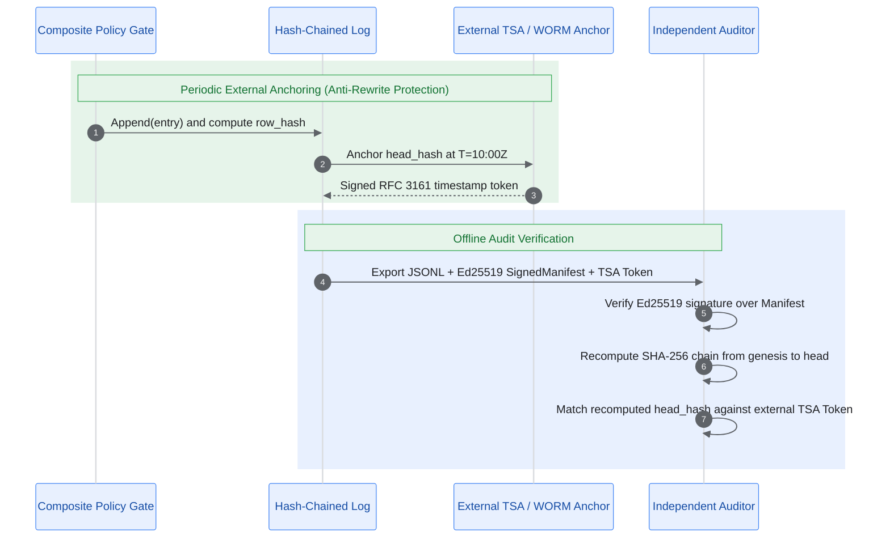

# Deep Dive 04: Tamper-Evident Audit Trails, External Anchoring & Approval Drift in Production

> **Companion to Slides [08–12](https://build-for-rbi-talk.vercel.app/#8), [`code/gate/approval_gate.go`](../../code/gate/approval_gate.go) & [`code/audit/chain.go`](../../code/audit/chain.go)**

---

## 1. Finding 1 Deep Dive — Why Governance Goes Stale Silently

Most teams implement an approval table that only answers: *"Does row `agent_id` have `status == 'approved'`?"* That fails in three real-world ways:

1. **Silent Scope Creep (`ErrRiskChanged`):** `var_calculator` was approved at `medium` risk as a read-only analytical helper. Six months later, a refactor gives it portfolio-rebalancing authority and updates its manifest to `high`. Because `status` is still `"approved"`, a naive check lets it run unreviewed.
2. **Stale Sign-Offs (`ErrExpired`):** Annual model re-validation passes silently unless the dispatch gate enforces `now.After(rec.ExpiresAt)`.
3. **Unreviewed Code Shipping (`ErrNoApproval`):** New high-risk agents introduced during a sprint bypass review unless the gate fails closed when `register[agentID] == nil`.

**Production Best Practice:** Bind the approval record not only to `risk_class`, but optionally to a **policy-relevant capability hash** (tools granted + data categories + target regions). Any change to tool permissions or risk tier invalidates the approval automatically at dispatch time.

---

## 2. Finding 2 Deep Dive — Catching Your Own Operator

A plain database audit table (`INSERT INTO audit_logs ...`) protects you against external attackers, **not against a privileged insider or DBA** who can run `UPDATE audit_logs SET actor = 'advisor-99' WHERE seq = 2`.

Our control combines **three boring, battle-tested primitives** (no blockchain required):

1. **SHA-256 Hash Chaining (`row_hash` binds `prev_hash`):** Editing any historical field invalidates every subsequent row's digest.
2. **Ed25519 Signed Export Manifest (`crypto/ed25519`):** Signs the verification summary — **including when `chain_verified: false`** — so nobody can intercept the export and flip `false` to `true`.
3. **External Timestamp Anchoring (RFC 3161 TSA or WORM Object Lock):** Prevents an attacker with database root access from rewriting and re-hashing the *entire* chain from `seq 1` forward, because the head hash anchored externally an hour ago will no longer match.

---

## 3. Scaling Hash-Chained Logs Under High Throughput

A single global mutex over one linear chain works great for thousands of events/sec in memory, but at bank-wide scale across multiple replicas:
- **Partition chains per tenant / agent shard** (e.g., 62 independent chains, each strictly ordered within its writer) so write contention disappears.
- **Anchor a Merkle root across all shard heads every 60 seconds** into WORM object storage (S3 Object Lock / GCS Bucket Lock) or an RFC 3161 TSA.
- **Keep the offline verifier identical:** Any single tenant's log can still be verified on a laptop in milliseconds.

---

## 4. Production Chaos Drills to Run in CI

Every control in this repo ships with a negative test proving it actually fails when it should:

| Failure Mode | Test Proving Detection | Command |
| --- | --- | --- |
| Agent silently drifts `medium` → `high` | `TestCheckApprovalDriftAndNormalization` (`ErrRiskChanged`) | `cd code && go test ./gate` |
| Customer revokes consent on Tuesday | `TestAppendOnlyConsentRevocationOnTuesday` | `cd code && go test ./consent` |
| Privileged operator edits audit row 2 | `TestHashChainDetectsTamperAndEnforcesPinnedKeyCrypto` | `cd code && go test ./audit` |
| Attacker forges `chain_verified: true` or substitutes key | `VerifySignedManifest` returns `false` | `cd code && go test ./audit` |
| 20 adversarial residency / RBAC / consent / drift payloads | `TestRedTeamCorpus` (`RT-01`..`RT-20`) | `cd code && go test ./redteam` |
