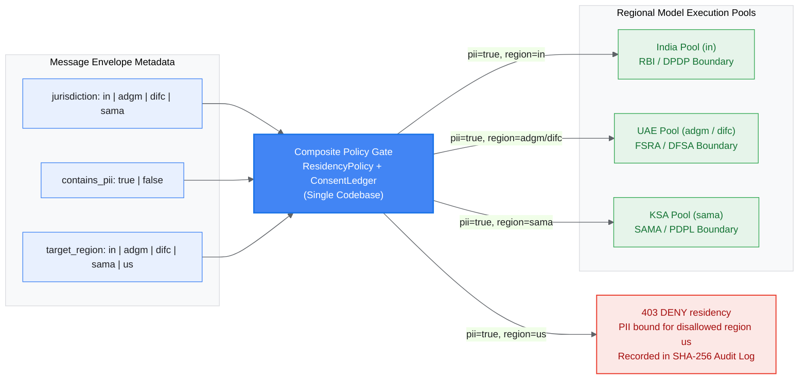

# Deep Dive 05: Per-Message Data Residency Across ADGM, DIFC, SAMA & India

> **Companion to [Slide 04](https://build-for-rbi-talk.vercel.app/#4), [Slide 05](https://build-for-rbi-talk.vercel.app/#5), [`code/gate/composite_gate.go`](../../code/gate/composite_gate.go) & [`labs/consent_ledger/main.go`](../../labs/consent_ledger/main.go)**  
> *"Residency, per message. Not per deployment — you cannot fork the platform once per country."*

---

## 1. The Multi-Jurisdiction Trap

Global banks and Open Banking platforms routinely operate across **India (RBI / DPDP)**, **ADGM (FSRA)**, **DIFC (DFSA)**, **Saudi Arabia (SAMA / PDPL)**, and **Europe (EU AI Act / GDPR)**.

The naive response is to **fork the entire AI platform per country** — 5 codebases, 5 CI pipelines, 5 prompt registries, 5 governance committees. Within two quarters, the forks diverge and an audit fix shipped in India never lands in SAMA.

The scalable alternative is **one unified codebase and message bus** where **residency is enforced per message envelope** at the Composite Policy Gate before any model or agent is invoked.

---

## 2. Per-Message Residency Routing Architecture

---

## 3. Multi-Jurisdiction Regulatory Matrix (Updated Nov 2026)

| Jurisdiction | Primary Regulator / Active 2025–2026 Instruments | Key Per-Message Enforcement Rule | Evidence Required on Demand |
| --- | --- | --- | --- |
| **India (`in`)** | RBI FREE-AI (13 Aug 2025), RBI Draft MRM Guidance (24 Jun 2026), **DPDP Rules, 2025** *(Consent Manager Rule 4 live **13 Nov 2026**; full enforcement **13 May 2027** — 1-yr log retention, 72-hr breach reporting, up to ₹250 Cr penalty)*, **MeitY IT Amendment Rules, 2026** *(20 Feb 2026 — SGI audio/visual labels & provenance)* & MeitY AI Governance Guidelines (Nov 2025) | Payment/PAN/Aadhaar PII remains inside Indian inference pools; honor revocations from interoperable DPBI Consent Managers; label synthetic AV outputs | Hash-chained audit log showing `region=in`, append-only consent history + refusal logs for outbound attempts |
| **ADGM (`adgm`)** | **FSRA Notice No. 222 of 2026** *(10 Nov 2026 — AI & Cyber Risk Management)* supplementing **ADGM Cyber Risk Management Framework (GEN 3.5, binding 31 Jan 2026)** & ADGM Data Protection Regulations | Integrate AI-enabled cyber threats (AI phishing, deepfakes, automated malware), AI-specific security testing, phishing-resistant MFA, and explicit DPR transfer adequacy/consent | Append-only consent ledger + AI security test records & transfer destination log |
| **DIFC (`difc`)** | DFSA, **DIFC Regulation 10** *(3-way **Deployer / Operator / Provider** roles, accredited high-risk AI certification, ISO 42001 alignment & ASO role)* & **DP Amendment Law No. 1 of 2025** *(effective 15 Jul 2025)* | Mandatory AI register, accredited certification & DPIAs, **Art. 6(3) "stable arrangements"** extraterritorial reach, subprocessor liability, Transfer Risk Assessments (TRAs), and **Art. 64A** private right of action in DIFC Courts | Live registry export + first-event disclosure (`Art 50` / `Rec 18`) + explainability rationale |
| **Saudi Arabia (`sama`)** | **SAMA Formal Commercial Open Banking Licensing** (AIS/PIS) & **Saudi PDPL (SDAIA)** | Strict in-Kingdom hosting/processing for customer & KYC data (external cloud requires explicit SAMA approval) + algorithmic explainability | Per-message routing proof & partner-bank data-lineage query |
| **Europe (`eu`)** | **EU AI Act** + **Digital Omnibus (`Regulation (EU) 2026/1744`, in force 27 Jul 2026)** & GDPR | Applies whenever output is used in Europe (`Art 2(1)(c)`); `Art 50` live since 2 Aug 2026 (legacy watermarking grace ends 2 Dec 2026); Annex III High-Risk & **Art. 27 FRIA** due 2 Dec 2027 | Dual Evidence Pack (`Art 12`, `Art 50`, `Annex IV`, `Art 27` FRIA) |

---

## 4. Answering Partner Banks on Demand

> *"Every partner bank is entitled to ask where their customer's data went — and 'encrypted at rest' is not an answer."*

Every message passing through [`CompositeGate`](../../code/gate/composite_gate.go) records:
1. **Subject / Actor ID & Partner Bank Tenant**
2. **Target Agent ID & Inference Region** (`in`, `adgm`, `difc`, `sama`)
3. **Consent Ledger Sequence Number** proving consent was live at exact execution time
4. **Outcome (`ALLOW` / `DENY`) + Policy Name** bound into the SHA-256 hash chain

When a partner bank asks *"Where did customer `user-1`'s data go between Nov 1 and Nov 28?"*, the platform exports a verifiable, Ed25519-signed slice of the audit chain in seconds.
