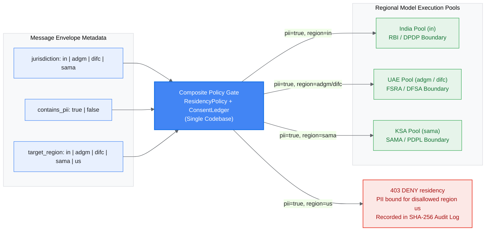

# Deep Dive 05: Per-Message Data Residency Across ADGM, DIFC, SAMA & India

> **Companion to [Slide 03](https://build-for-rbi-talk.vercel.app/#3), [`code/gate/composite_gate.go`](../../code/gate/composite_gate.go) & [`code/python/consent_ledger.py`](../../code/python/consent_ledger.py)**  
> *"Residency, per message. Not per deployment — you cannot fork the platform once per country."*

---

## 1. The Multi-Jurisdiction Trap

Global banks and Open Banking platforms routinely operate across **India (RBI / DPDP)**, **ADGM (FSRA)**, **DIFC (DFSA)**, **Saudi Arabia (SAMA / PDPL)**, and **Europe (EU AI Act / GDPR)**.

The naive response is to **fork the entire AI platform per country** — 5 codebases, 5 CI pipelines, 5 prompt registries, 5 governance committees. Within two quarters, the forks diverge and an audit fix shipped in India never lands in SAMA.

The scalable alternative is **one unified codebase and message bus** where **residency is enforced per message envelope** at the Composite Policy Gate before any model or agent is invoked.

---

## 2. Per-Message Residency Routing Architecture

---

## 3. Multi-Jurisdiction Regulatory Matrix

| Jurisdiction | Primary Regulator / Law | Key Per-Message Enforcement Rule | Evidence Required on Demand |
| --- | --- | --- | --- |
| **India (`in`)** | RBI FREE-AI, RBI Payment Data Storage, DPDP Act | Payment/PAN/Aadhaar PII must remain inside approved Indian inference regions | Hash-chained audit log showing `region=in` + refusal logs for outbound attempts |
| **ADGM (`adgm`)** | FSRA & ADGM Data Protection Regulations | Cross-border transfers require explicit adequacy/consent proof | Append-only consent ledger + transfer destination record |
| **DIFC (`difc`)** | DFSA & DIFC Data Protection Law | Automated decisioning requires lawful basis, disclosure & human recourse | First-event disclosure (`Art 50` / `Rec 18`) + explainability rationale |
| **Saudi Arabia (`sama`)** | SAMA Open Banking & Saudi PDPL | Strict in-kingdom storage/processing for regulated banking data | Per-message routing proof & partner-bank data-lineage query |
| **Europe (`eu`)** | EU AI Act & GDPR | Applies whenever output is used in Europe (`Art 2(1)(c)`) | Dual Evidence Pack (`Art 12`, `Art 50`, `Annex IV`) |

---

## 4. Answering Partner Banks on Demand

> *"Every partner bank is entitled to ask where their customer's data went — and 'encrypted at rest' is not an answer."*

Every message passing through [`CompositeGate`](../../code/gate/composite_gate.go) records:
1. **Subject / Actor ID & Partner Bank Tenant**
2. **Target Agent ID & Inference Region** (`in`, `adgm`, `difc`, `sama`)
3. **Consent Ledger Sequence Number** proving consent was live at exact execution time
4. **Outcome (`ALLOW` / `DENY`) + Policy Name** bound into the SHA-256 hash chain

When a partner bank asks *"Where did customer `user-1`'s data go between Nov 1 and Nov 28?"*, the platform exports a verifiable, Ed25519-signed slice of the audit chain in seconds.
