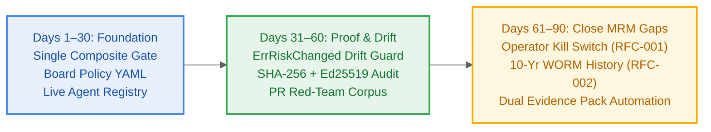

# Deep Dive 06: Preparing for the Binding RBI Draft Model Risk Management Guidance (24 June 2026)

> **Companion to Slides [23–25](https://build-for-rbi-talk.vercel.app/#23), [`RFC-001`](../open-problems/RFC-001-ai-kill-switch.md) & [`RFC-002`](../open-problems/RFC-002-ten-year-retention.md)**  
> *"FREE-AI was advice; this will not be."*

---

## 1. Why the June 2026 Draft Changes the Engineering Bar

Many teams stopped reading after RBI's **FREE-AI** committee report (13 August 2025). FREE-AI is an advisory framework — invaluable as an architectural map, but non-binding.

On **24 June 2026**, RBI issued the **Draft Guidance on Regulatory Principles for Model Risk Management, 2026** for public consultation (comments closed **24 July 2026**, final circular pending as of November 2026). Once finalised as a Master Direction / circular, supervised entities will be inspected directly against it.

### Scope & What Changed From Earlier Credit-Risk Guidelines
- **Broad Institutional Coverage (11 Categories of REs):** Applies across commercial banks, small finance banks, payments banks, regional rural banks, urban/rural co-operative banks, NBFCs (across all layers), ARCs, CICs, and All-India Financial Institutions (AIFIs).
- **Expansive Model Definition:** Explicitly covers traditional statistical models, ML, **Generative AI, frontier foundation models, third-party vendor algorithms, and material decision-making spreadsheets**.
- **Third-Party Client-Side Override Mandate:** Regulated entities remain **100% accountable** for vendor-supplied models — including ensuring **client-side override / deactivation ("kill-switch") capabilities** independent of the vendor's underlying software logic.

---

## 2. Detailed Readiness Breakdown Across All 6 Core Requirements

| # | Draft MRM Requirement | Current Repo Status | What Auditors Will Actually Inspect |
| :-: | --- | :-: | --- |
| **1** | **Board-approved model risk framework** | ✅ **Built** | Signed/versioned policy YAML ([`code/config/policy.yaml`](../../code/config/policy.yaml)), review cadence (`90d`), explicit risk appetite |
| **2** | **Full model inventory — nothing outside it** | ✅ **Built** | Runtime-generated live registry export ([`code/registry/registry.go`](../../code/registry/registry.go)) proving shadow models cannot execute |
| **3** | **Risk tiering by materiality, complexity & autonomy** | ✅ **Built** | Pre-dispatch tier check + runtime drift detection ([`code/gate/approval_gate.go`](../../code/gate/approval_gate.go) `ErrRiskChanged`) |
| **4** | **Accountability for vendor models (certified or not)** | ✅ **Built** | Vendor model metadata in live registry + [5-Minute Vendor Procurement Test](../VENDOR-CHECKLIST.md) |
| **5** | **Mandatory AI kill switch** | ⚠️ **Gap (`RFC-001`)** | Sub-second operator-triggered hard stop (scoped & global), in-flight cancellation, chaos-drill audit records |
| **6** | **10-year retention including decommissioned models** | ⚠️ **Gap (`RFC-002`)** | Immutable historical inventory reconciled with zero-drift live registry, tamper-evident across a 10-year horizon |

### Two Additional Operational Mandates to Plan For in the June 2026 Draft
Beyond the 6-item architectural scorecard above, the June 2026 draft explicitly raises two operational requirements that engineering & product teams should bake into release checklists:
1. **Seamless Chatbot-to-Human Handoff:** Customer-facing AI/chatbots must disclose AI interaction, state limitations, and offer a clear, unhindered (one-click, non-buried) path to reach a live human representative — paired with anti-automation-bias safeguards for human reviewers.
2. **Independent Model Validation (3 Lines of Defense):** Objective pre-deployment and ongoing validation strictly separated from model developers — including independent local validation of third-party vendor "black-box" models (vendor attestations alone do not suffice) and explicit **Risk Management Committee of the Board (RMCB)** sign-off for high-risk models.

---

## 3. A Practical 90-Day Engineering Roadmap for Regulated Entities

### Phase Breakdown
- **Days 1–30 (Eliminate Fragmentation):** Route all AI traffic through one Composite Policy Gate, move hardcoded rules into board-approved `policy.yaml`, and turn on live registry inventory exports so no shadow agent can boot silently.
- **Days 31–60 (Make Controls Operator-Proof):** Enforce `ErrRiskChanged` and `ErrExpired` at dispatch time, deploy SHA-256 hash-chained logging with Ed25519 signed manifests, and run a red-team corpus in CI on every PR.
- **Days 61–90 (Close the Two Binding MRM Gaps):** Implement an operator-triggered kill switch (`RFC-001`) with regular chaos drills (see [CrowdStrike's Falcon Guardian AI Kill Switch](https://www.crowdstrike.com/en-us/blog/crowdstrike-introduces-ai-kill-switch/) for an emerging 4-layer reference covering AI gateway cut-off, process termination, relaunch prevention, and network isolation), and pair the live registry with an append-only WORM lifecycle ledger (`RFC-002`) to satisfy 10-year decommissioned retention without reintroducing inventory drift.
