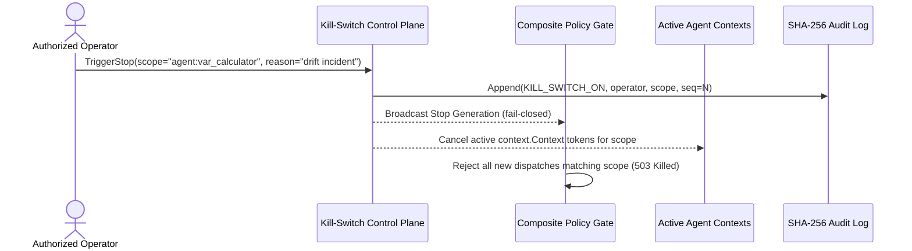

# RFC-001: Mandatory Operator-Triggered AI Kill Switch

- **Status:** Open Engineering Problem (`GAP 01`)
- **Regulatory Trigger:** RBI Draft Model Risk Management Guidance (24 June 2026) — Mandatory AI Kill Switch
- **Related Slides:** [Slide 18](https://build-for-rbi-talk.vercel.app/#18), [Slide 19](https://build-for-rbi-talk.vercel.app/#19)

---

## 1. Problem Statement

The current system already implements **automated safety controls**:
- Circuit breakers on downstream failures
- Execution deadlines & per-request timeouts
- Token/cost budget caps
- Deterministic fallbacks

However, the RBI Draft MRM Guidance mandates an explicit **AI kill switch** — an **operator-triggered hard stop**. Automated circuit breakers are adjacent, **not the same thing**.

## 2. Why This Is Non-Trivial in a Multi-Agent Bus

In a 62-agent system behind a Composite Policy Gate:
1. **In-flight cancellation:** Blocking *new* messages at the gate is straightforward, but long-running or multi-hop agent workflows already past the gate must terminate deterministically.
2. **Scoped vs. global stop:** Operators need granular levels — kill one agent (`var_calculator`), kill a risk tier (`high`), or kill the entire AI platform — without taking down non-AI core banking flows.
3. **Auth & dual-control:** A kill switch that anyone can press is a DoS vector; a kill switch that takes 30 minutes of approvals is useless during an active incident.
4. **Audit proof:** Every activation and re-enablement must be recorded in the SHA-256 hash-chained audit log with operator identity, timestamp, scope, and blast radius.

## 3. Proposed Architecture Direction (Draft for Discussion)

## 4. Open Questions — How Have You Solved This?

- How do you guarantee sub-second propagation across stateless replicas without creating a single point of failure in the hot path?
- What is the safest re-arm / resume workflow (e.g., dual-custody sign-off + fresh risk-class verification)?
- How do you test the kill switch continuously in production (chaos drills) without causing customer impact?

> Have a working pattern or critique? [Open a proposal issue](../../issues/new?template=open-problem-proposal.md) referencing `RFC-001`.
