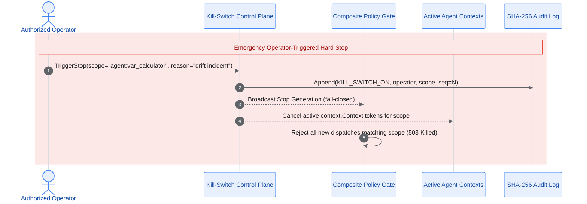

# RFC-001: Mandatory Operator-Triggered AI Kill Switch

- **Status:** Open Engineering Problem (`GAP 01`)
- **Regulatory Trigger:** RBI Draft Model Risk Management Guidance (24 June 2026) — Mandatory AI Kill Switch
- **Related Slides:** [Slide 18](https://build-for-rbi-talk.vercel.app/#18), [Slide 19](https://build-for-rbi-talk.vercel.app/#19)

---

## 1. Problem Statement

The current system already implements **automated safety controls**:
- Circuit breakers on downstream failures
- Execution deadlines & per-request timeouts
- Token/cost budget caps
- Deterministic fallbacks

However, the RBI Draft MRM Guidance mandates an explicit **AI kill switch** — an **operator-triggered hard stop**. Automated circuit breakers are adjacent, **not the same thing**.

## 2. Why This Is Non-Trivial in a Multi-Agent Bus

In a 62-agent system behind a Composite Policy Gate:
1. **In-flight cancellation:** Blocking *new* messages at the gate is straightforward, but long-running or multi-hop agent workflows already past the gate must terminate deterministically.
2. **Scoped vs. global stop:** Operators need granular levels — kill one agent (`var_calculator`), kill a risk tier (`high`), or kill the entire AI platform — without taking down non-AI core banking flows.
3. **Auth & dual-control:** A kill switch that anyone can press is a DoS vector; a kill switch that takes 30 minutes of approvals is useless during an active incident.
4. **Audit proof:** Every activation and re-enablement must be recorded in the SHA-256 hash-chained audit log with operator identity, timestamp, scope, and blast radius.

## 3. Proposed Architecture Direction (Draft for Discussion)

## 4. Industry Reference & Prior Art

- **[CrowdStrike Introduces AI Kill Switch (Falcon Guardian, 3 Nov 2026)](https://www.crowdstrike.com/en-us/blog/crowdstrike-introduces-ai-kill-switch/)** — Announced at Fal.Con Europe, CrowdStrike's AI Kill Switch illustrates an emerging **four-layer enforcement pattern** for stopping rogue autonomous agents in production:

| Enforcement Layer (CrowdStrike Falcon Guardian) | Equivalent Problem in a Multi-Agent Banking Platform |
| --- | --- |
| **1. AI Gateway Cut-Off** — Blocks the agent's access to underlying AI models/providers via connected AI gateways | **Composite Policy Gate fail-closed broadcast** — Rejects all new dispatches matching the killed scope |
| **2. Process Termination at the Root** — Terminates the running agent process on the endpoint | **In-flight context cancellation** — Cancels active `context.Context` trees & multi-hop tool calls |
| **3. Relaunch Prevention** — Blocks terminated agents from automatically restarting on hosts | **Control-plane lease & startup block** — Prevents Kubernetes/orchestrator liveness probes from re-spawning the killed agent |
| **4. Network Isolation** — Cuts off enterprise network access to stop lateral movement or data spread | **Egress & bus quarantine** — Revokes downstream API/DB credentials and logs the blast radius to the SHA-256 audit chain |

> **Why this remains an open gap for our codebase:** Commercial AIDR/endpoint tools show that gateway + runtime termination is becoming a real industry pattern, but regulated entities still have to wire operator-triggered kill controls across **application-level multi-agent buses, dual-custody approval workflows, and tamper-evident audit trails** (RBI Draft MRM Guidance — which also requires **client-side override/deactivation controls on third-party vendor models**).

### Hard Stop vs. "Dimmer Switch" Containment Spectrum (Financial Services Pattern)

Financial CISOs implementing NIST AI RMF / OWASP Agentic Security (`ASI Top 10`) guidance increasingly pair an emergency hard stop with **tiered containment** so stopping a misbehaving agent doesn't inadvertently freeze legitimate payment queues:

1. **Dimmer Switch (Granular Degrade):** Dynamically shift an agent to read-only mode, strip high-risk tool scopes (`ASI02`), or force mandatory human-in-the-loop (HITL) sign-off above a transaction threshold via an external policy proxy.
2. **Identity / NHI Revocation:** Immediately revoke short-lived OAuth tokens, service-account credentials, or API keys in the IAM layer (`ASI03`) so the agent cannot call core banking rails even if a worker container hangs.
3. **Hard Stop (Full Kill Switch):** Broadcast fail-closed scope termination to the Composite Policy Gate, cancel active `context.Context` trees, block orchestrator relaunch, and write an immutable `KILL_SWITCH_ON` record to the SHA-256 audit log.

## 5. Open Questions — How Have You Solved This?

- How do you guarantee sub-second propagation across stateless replicas without creating a single point of failure in the hot path?
- What is the safest re-arm / resume workflow (e.g., dual-custody sign-off + fresh risk-class verification)?
- How do you test the kill switch continuously in production (chaos drills) without causing customer impact?

> Have a working pattern or critique? [Open a proposal issue](https://github.com/PratikDhanave/Build-For-RBI-Inherit-The-EU-AI-Act/issues/new?template=open-problem-proposal.md) referencing `RFC-001`.
